## Part 1. Инструмент ipcalc

1.1 Сети и маски
  1.1.1 Адрес сети _192.167.38.54/13_Адрес сети 192.167.38.54/13 = 192.160.0.0
  
  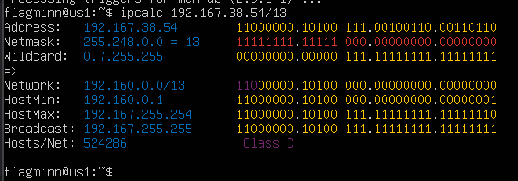
 1.1.2 Перевод маски 255.255.255.0 в префиксную и двоичную запись, /15 в обычную и двоичную, 11111111.11111111.11111111.11110000_ в обычную и префиксную
	- 255.255.255.0:  префикс: /24, двоичная: 11111111.11111111.11111111.00000000  
	- /15: обычная: 255.254.0.0, двоичная: 11111111.11111110.00000000.00000000  
	- 11111111.11111111.11111111.11110000: обычная: 255.255.255.240, префикс: /28
 1.1.3. Минимальный и максимальный хост в сети 12.167.38.4 при масках: /8, 11111111.11111111.00000000.00000000, 255.255.254.0 и /4
	- /8: мин. 12.0.0.1, макс. 12.255.255.254  
	- /16: мин. 12.167.0.1, макс. 12.167.255.254  
	- /23: мин. 12.167.38.1, макс. 12.167.39.254  
	- /4: мин. 0.0.0.1, макс. 15.255.255.254
 
1.2 localhost
1.2.1 Определи и запиши в отчёт, можно ли обратиться к приложению, работающему на localhost, со следующими IP:
	- 194.34.23.100: нет  
	- 127.0.0.2: да  
	- 127.1.0.1: да
	- 128.0.0.1:  нет

1.3 Диапазоны и сегменты сетей
1.3.1 Какие из перечисленных IP можно использовать в качестве публичного, а какие только в качестве частных: _10.0.0.45_, _134.43.0.2_, _192.168.4.2_, _172.20.250.4_, _172.0.2.1_, _192.172.0.1_, _172.68.0.2_, _172.16.255.255_, _10.10.10.10_, _192.169.168.1_
	- 10.0.0.45: Частный
	 - 134.43.0.2: Публичный
	 - 192.168.4.2:  Частный 
	 - 172.20.250.4: Частный 172.16–172.3
	 - 172.0.2.1: Публичный 
	 - 192.172.0.1: Публичный
	 - 172.68.0.2: Публичный
	 - 172.16.255.255: Частный
	 - 10.10.10.10: Частный
	 - 192.169.168.1: Публичный

1.3.2. У сети 10.10.0.0/18 возможные шлюзы:  
	- 10.10.0.2  
	- 10.10.10.10  
	- 10.10.1.255
## Part 2. Статическая маршрутизация между двумя машинами

2.0.1 Поднял две виртуальные машины (далее - ws1 и ws2).
2.0.2 Смотрю существующие сетевые интерфейсы при помощи команды ip a
- Вывод команды ip a на ws1 

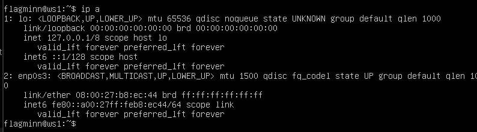
- Вывод команды ip a на ws2 

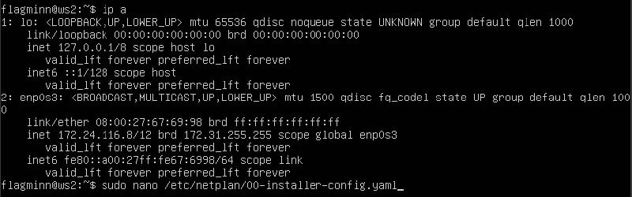

2.0.3Задаю следующие адреса и маски: ws1 - 192.168.100.10, маска /16, ws2 - 172.24.116.8, маска /12.
- Измененный файл etc/netplan/00-installer-config.yaml на ws1 

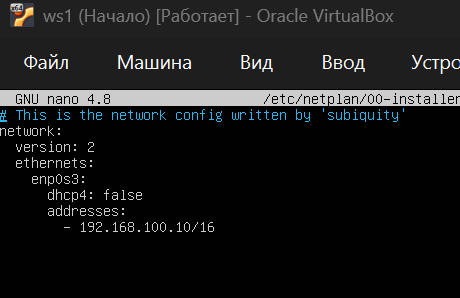
- Измененный файл etc/netplan/00-installer-config.yaml на ws2 

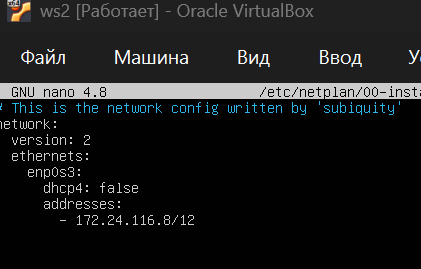

-  Скрин команды ip a после команды netplan apply на ws1 

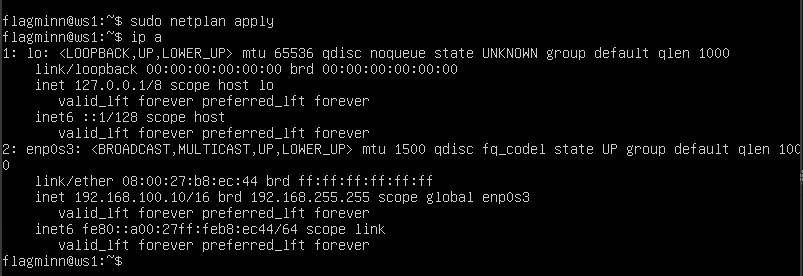
-  Скрин команды ip a после команды netplan apply на ws2 

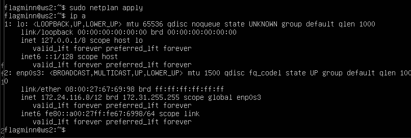

2.1. Добавление статического маршрута вручную

- Добавил статический маршрут от одной машины до другой и обратно при помощи команды вида ip r add.
-   Скрин вывода команды ping на ws1 

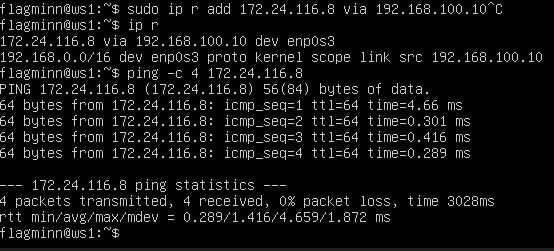
- Скрин вывода команды ping на ws2 

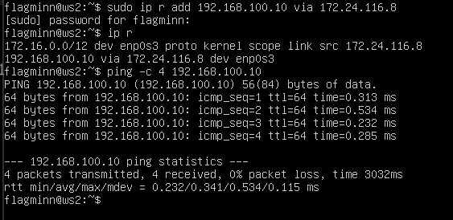

2.2. Добавление статического маршрута с сохранением

- Перезапустил машины командой sudo reboot
- Добавляю статический маршрут от ws1 до ws2 с помощью файла /etc/netplan/00-installer-config.yaml

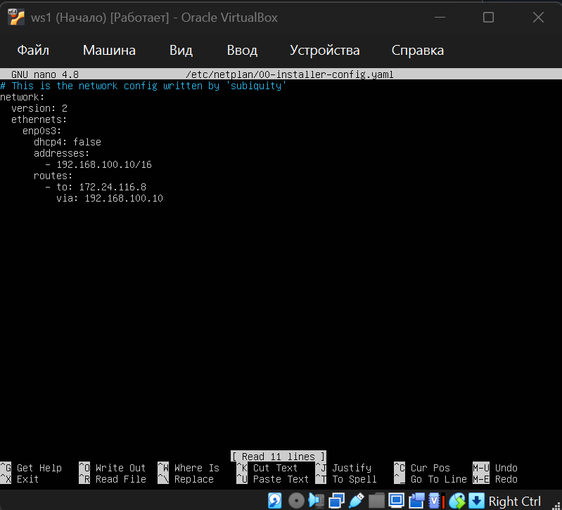
-  Добавляю статический маршрут от ws2 до ws1 с помощью файла /etc/netplan/00-installer-config.yaml

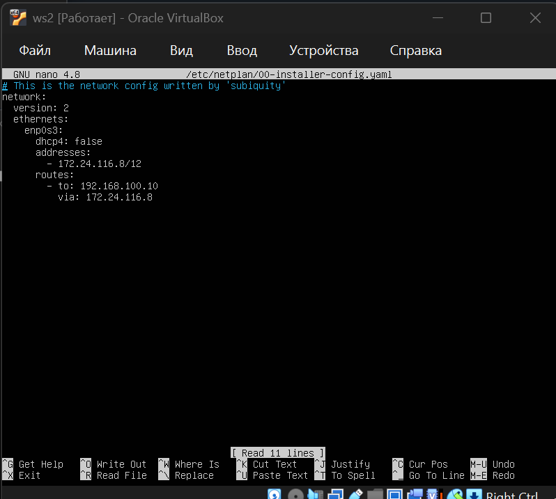

- Пингую соединение с ws1 

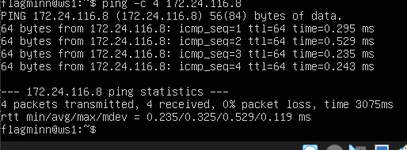 
- Пингую соединение с ws2 

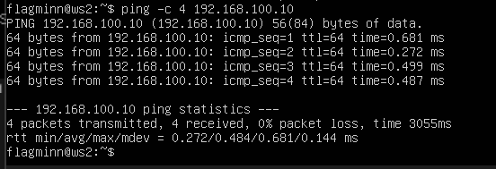

## Part 3. Утилита **iperf3**
3.1. Скорость соединения. Перевод единиц измерения скорости соединения: 
- 8 Mbps = 1MB/s, 
- 100 MB/s = 800 000 Kbps, 
- 1 Gbps = 1000 Mbps.

3.2. Утилита iperf3
- Для скачивания временно сменил Внутреннюю сеть на NAT и изменил конфиг

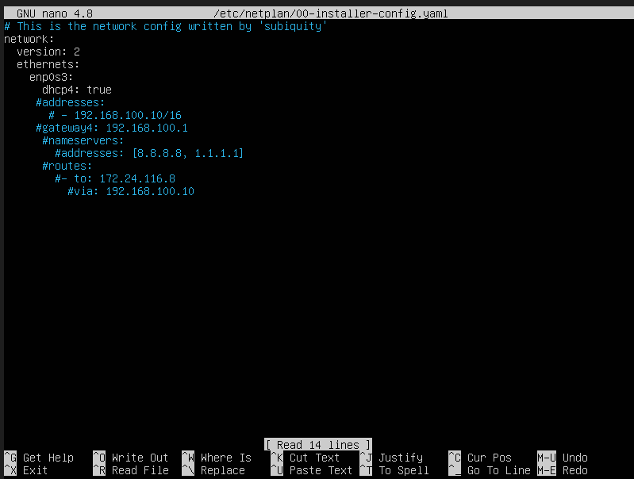

- Для измерения скорости соединения между ws1 и ws2 запускаю сервер на ws2 

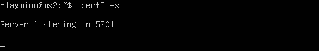
- Подключаюсь к серверу в качестве клиента с ws1 

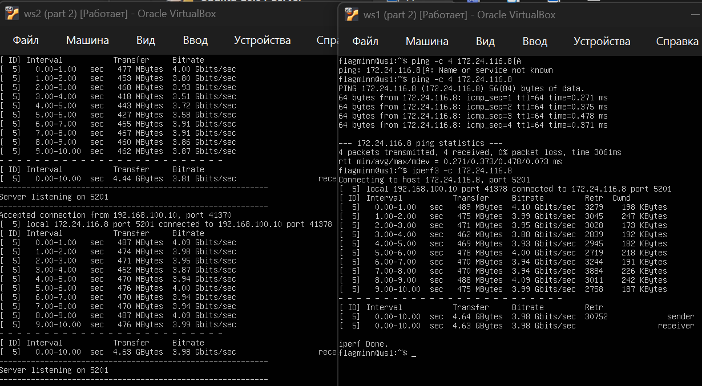

## Part 4. Сетевой экран

4.1. Утилита **iptables**
- Создал файл /etc/firewall.sh на ws1 и ws2:
- Содержание файла /etc/firewall.sh на ws2 

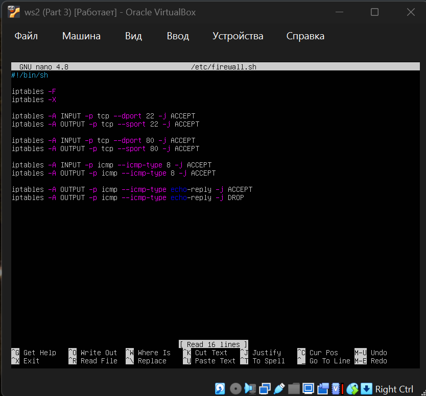
- Содержание файла /etc/firewall.sh на ws1 

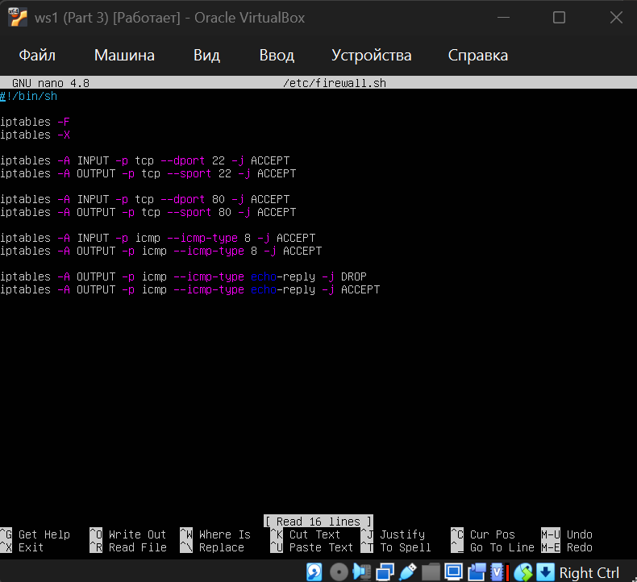

- Запустил файлы на обеих машинах с предоставлением прав на исполнение файла
- Запуск файла на ws1 

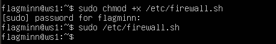
- Запуск файла на ws2 

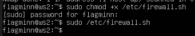

- Описание разницы стратегий: На ws1 применена стратегия: сначала запрет, потом разрешение. Поскольку правила обрабатываются последовательно, первое правило (DROP) имеет приоритет — машина не отвечает на ping. На ws2 применена стратегия: сначала разрешение, потом запрет. Первое правило (`ACCEPT`) срабатывает — машина отвечает на ping.

4.2. Утилита nmap
- Пинг с ws2 на ws1. Пакеты утеряны. Машина ws1 не пингуется 

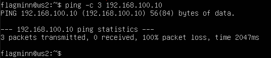
- Пинг с ws1 на ws2 прошел успешно 

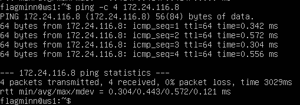
- Машина ws1 не пингуется, но nmap подтверждает: Host is up 

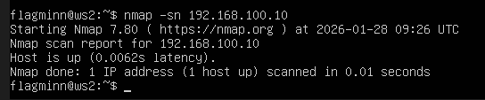

## Part 5. Статическая маршрутизация сети

- Поднял пять виртуальных машин (3 рабочие станции (ws11, ws21, ws22) и 2 роутера (r1, r2)).

5.1. Настройка адресов машин. Настроил конфигурации машин в etc/netplan/00-installer-config.yaml согласно сети на предоставленном в задании рисунке.

-  Конфигурация etc/netplan/00-installer-config.yaml на ws11 

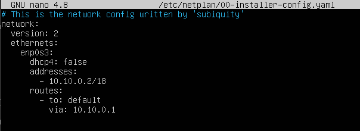
-  Конфигурация etc/netplan/00-installer-config.yaml на  ws21 

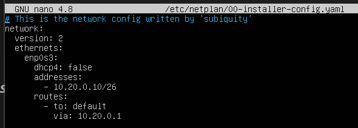
-  Конфигурация etc/netplan/00-installer-config.yaml на ws22 

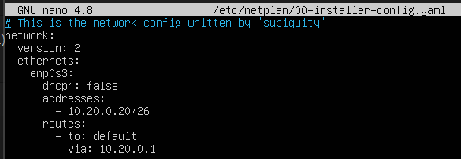
- Конфигурация etc/netplan/00-installer-config.yaml на r1 

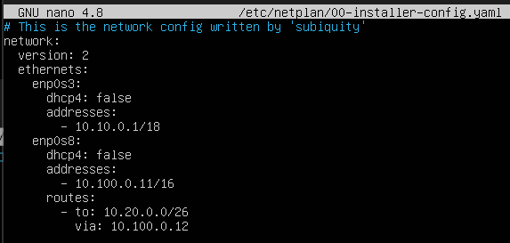
- Конфигурация etc/netplan/00-installer-config.yaml на r2 

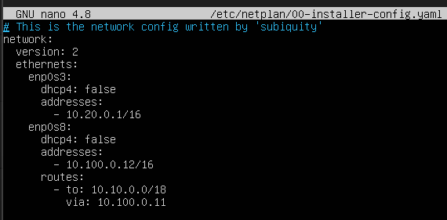

- Перезапустил сервис сети. Ошибок не было, командой `ip -4 a` проверил, что адрес машины задан верно:

	-   Вывод команды ip -4 a на ws11. Адрес машины задан верно.  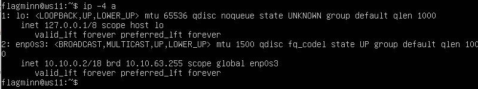
	- Вывод команды ip -4 a на r1. Адрес машины задан верно. 
	
	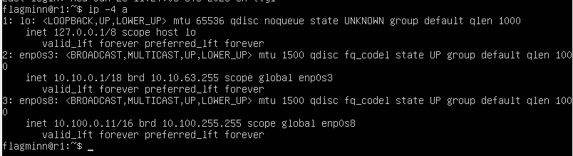
	- Вывод команды ip -4 a на r2. Адрес машины задан верно. 
	
	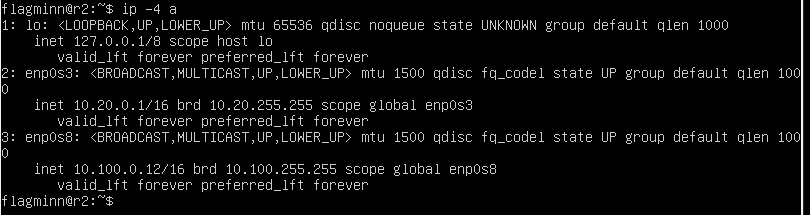
	- Вывод команды ip -4 a на ws21. Адрес машины задан верно.  
	
	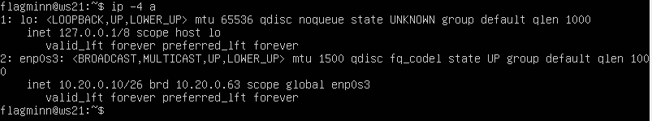
	- Вывод команды ip -4 a на ws22. Адрес машины задан верно.  
	
	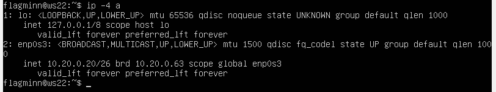
- Пропинговал ws22 с ws2 

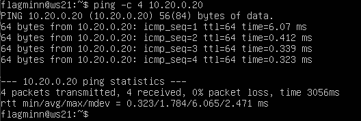
- Также пропинговал r1 с ws11. 

5.2. Включение переадресации IP-адресов

- Для включения переадресации IP выполнил команду на роутерах: sysctl -w net.ipv4.ip_forward=1:

	- на r1 
	
	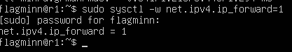
	- на r2 
	
	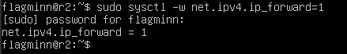

- В файле /etc/sysctl.conf добавил строку net.ipv4.ip_forward = 1 

	- на r1 
	
	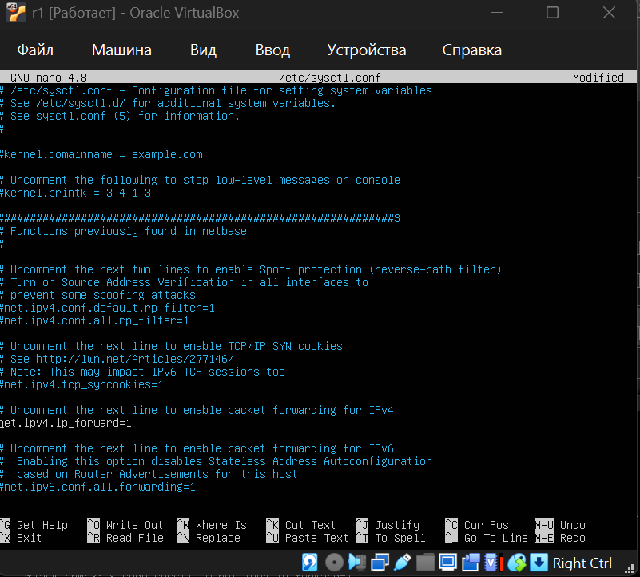
	на r2 
	
	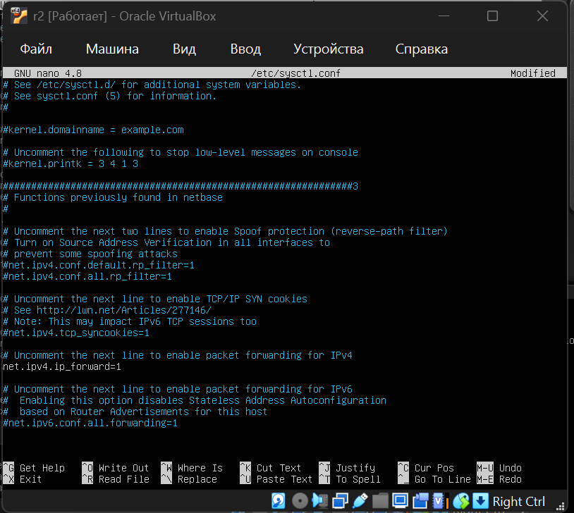
- Проверка переадресации на r1 

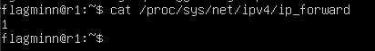
- Проверка переадресации на r2 

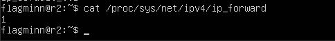
5.3. Установка маршрута по умолчанию

- Настроил маршрут по умолчанию (шлюз) для рабочих станций. Для этого добавил default перед IP-роутера в файле конфигураций: 

	- на ws1 
	
	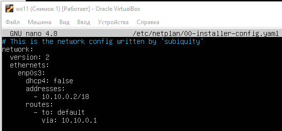
	- на ws21 
	
	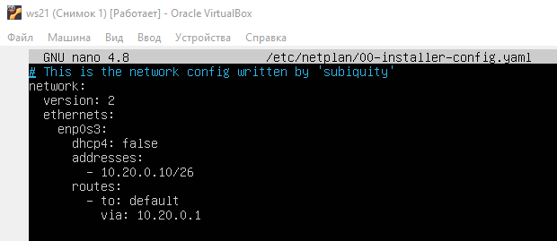
	- на ws22 
	
	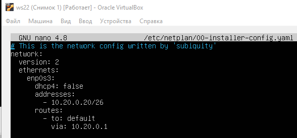
- Вывод команды ip r. Маршруты на ws11 

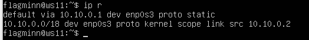
- Вывод команды ip r. Маршруты на ws21 

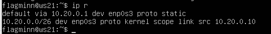
- Вывод команды ip r. Маршруты на ws22 

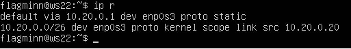

- Пропинговал с ws11 роутер r2 

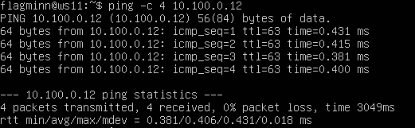
- Вывод команды tcpdump -tn -i eth0 в подтверждение того, что пинг дошел на r2 

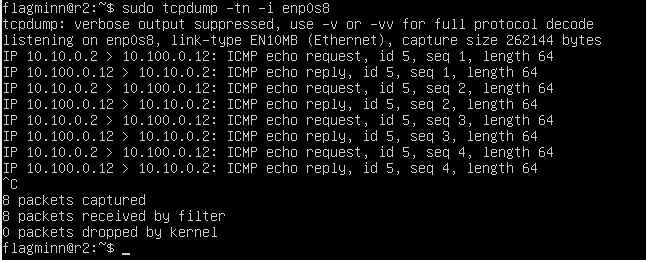

5.4. Добавление статических маршрутов. 

- Добавил статические маршруты в файле конфигураций еtc/netplan/00-installer-config.yaml на r1 

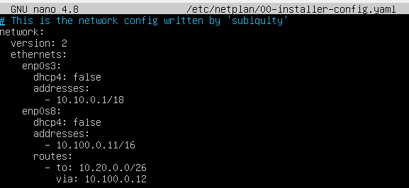
- Добавил статические маршруты в файле конфигураций еtc/netplan/00-installer-config.yaml на r2 

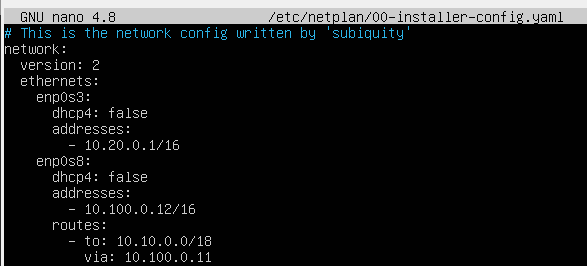
- Вывод команды ip r после добавления статических маршрутов в файле конфигурации на  r1 

- Вывод команды ip r после добавления статических маршрутов в файле конфигурации на  r2 

- Запустил  на ws11 команды ip r list 10.10.0.0/18 и ip r list 0.0.0.0/0 

- Объяснение почему для адреса 10.10.0.0/18 был выбран маршрут, отличный от 0.0.0.0/0, хотя он попадает под маршрут по умолчанию: Потому что более конкретный маршрут имеет приоритет (правило longest prefix match). /18 точнее, чем /0 → выбирается он.

5.5. Построение списка маршрутизаторов

- Вывод утилиты traceroute на ws11 

- Вывод tcpdump на r1 

- Принцип traceroute:  Отправляет пакеты с TTL=1, 2, 3 и т.д.  Когда TTL истекает, роутер отправляет ICMP time-exceeded. Так строится путь.

5.6. Использование протокола **ICMP** при маршрутизации
- Результат работы tcpdump на r1. Отвечает destination-unreachable, потому что нет маршрута до 10.30.0.0/24. 

- Пинг r1 с ws1 

## Part 6. Динамическая настройка IP с помощью **DHCP**

- В файле /etc/dhcp/dhcpd.conf указал адрес маршрутизатора по умолчанию, DNS-сервер и адрес внутренней сети на r2 

- В файле resolv.conf прописал nameserver 8.8.8.8 на r2 

- Перезагружаю службу DHCP

- r2 указываю интерфейс 

- Вывод команды ip а на ws21 

- С ws21 пропинговал ws22 

- На ws11 в etc/netplan/00-installer-config.yaml  добавил строки: macaddress: 10:10:10:10:10:BA, dhcp4: true. 

- Изменил файл конфига DHCP на r1 аналогично r2, но с выдачей по МАС-адресу 

- Содержание файла /etc/default/isc-dhcp-server на r1 

- Проверка статуса DHCP на r1 

- Вывод  a ws11 до обновления 

- Вывод ip a ws11 после обновления 

- Используемые опции DHCP: dhclient -r  команда освобождает текущую аренду (release), dhclient без флагов — запрашивает новую аренду у сервера (renew).

## Часть 7. **NAT**

В файле /etc/apache2/ports.conf на ws22 и r1 изменил строку Listen 80 на Listen 0.0.0.0:80.

- В файле /etc/apache2/ports.conf на ws22 изменил строку Listen 80 на Listen 0.0.0.0:80 

- В файле /etc/apache2/ports.conf на r1 изменил строку Listen 80 на Listen 0.0.0.0:80 

- Запустил веб-сервер Apache на r1 

- Запустил веб-сервер Apache наws22 

При запуске файла с этими правилами ws22 не должна пинговаться с r1.

- Создал на r2 фаервол с политикой на запрет

- Включиk IP-форвардинг на r2 

- Запустил фаервол 

- Пропинговал ws22 с r1. Пинг не прошел 

- И обратно тоже не прошел

- Добавил в фаервол правило. Разрешил маршрутизацию всех пакетов ICMP 

- Запустил фаервол 

- Пропинговал ws22 с r1. Пинг прошел 

- Пропинговал r1 с ws22. Пинг также прошел

- Добавил еще 2 правила в фаервол. Включил SNAT и DNAT на 8080 порт машины r2 и добавить к веб-серверу Apache, запущенному на ws22, доступ извне сети 

- Запустил фаервол 

- Вывод утилиты telnet на ws22 

- Вывод утилиты telnet на r1 

## Part 8. Дополнительно. Знакомство с **SSH Tunnels**

- В отчёте опиши команды, необходимые для выполнения этих четырёх пунктов, а также приложи скриншоты с их вызовом и выводом.
- Запускаю фаервол на r2 

- Изменяю файл конфига /etc/apache2/ports.con на ws22 

- рестарт веб-сервер Apache2 на ws22 

- Через ws21 захожу по ssh в ws22 

- С ws21 на ws22 зашло успешно 

- Проверка: вывод утилиты telnet с ws21 

- с ws21 пытаюсь подключиться к ws22 через r2 

- С ws21 на ws22 зашло успешно 

 - проверка на ws11, вывод утилиты telnet, подключено 

 
