## Part 1. Готовый докер
* Скачаиваю образ nginx
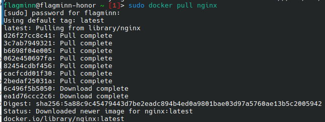
* Проверяю какие образы в настоящий момент доступны и запускаю контейнер с nginx 
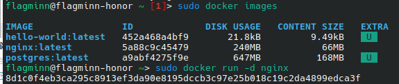

* Проверяю список запущенных контейнеров
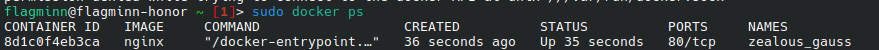

* Вывод команды docker inspect
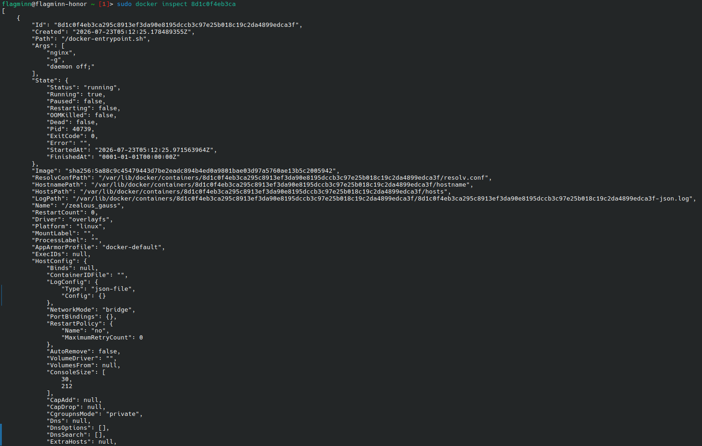

* Размер контейнера составляет:
Полный размер с образом 174137344;
Размер изменений этого контейнера 8192
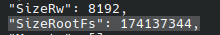

* 80 порт выставлен, но не замаплен
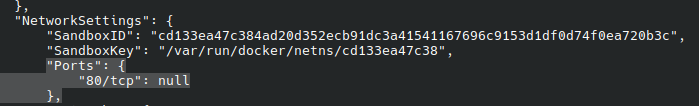
* IP-адресс контейнера - 172.17.0.2
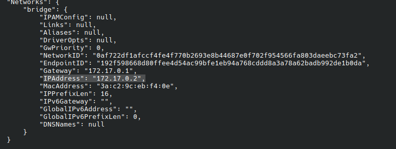

* Останавливаем контейнер и проверяем список контейнеров
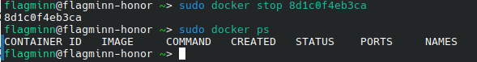

* Запускаем контейнер с пробросом портов 80 и 443
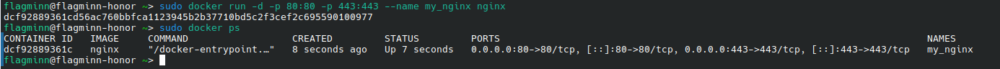

* Стартовая страница nginx по адресу http://localhost:80
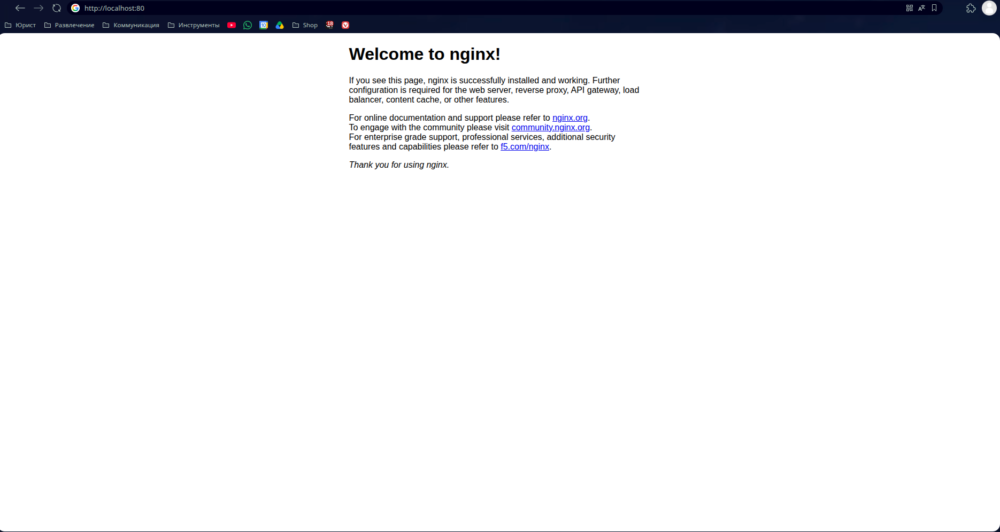

* Перезапускаю контейнер
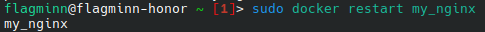

* Контейнер перезапустился
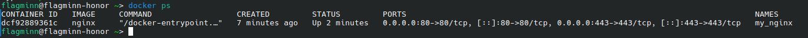

## Part 2. Операции с контейнером

* Смотрю конфигурационный файлл nginx 
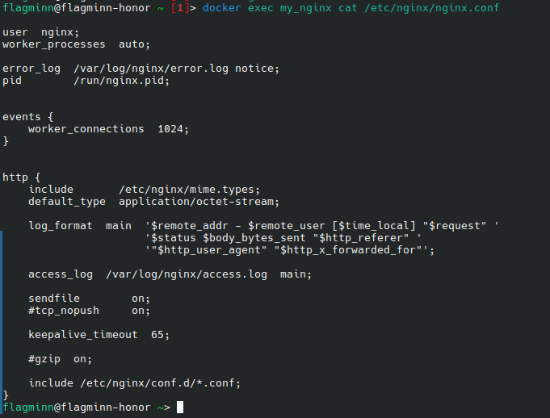

* В скрине видно, что часть конфигурации, отвечающая за сервер подтягивается из другого файла. Открываю этот файл, чтобы посмотреть как там выглядит конфигурация. Затем копирую блок и вставляю в основной файл кофигурации.
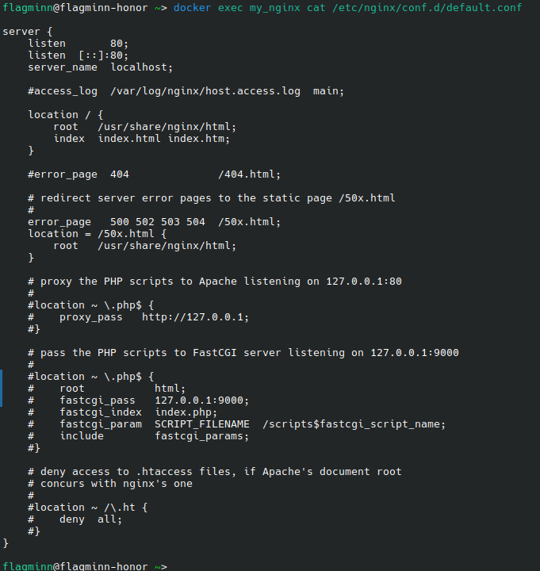

* Добавляю в конфигураию сервера статус
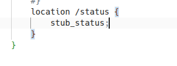

* Копирую файл конфигурации внутрь контейнера
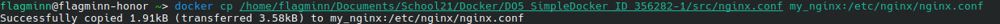

* Перезапускаю сигнал сервера
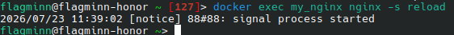

* Теперь можем видеть статистику
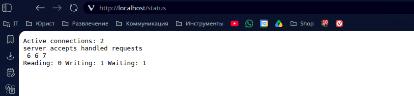

* Экспортирую контейнер. Останавливаю контейнер. Удаляю образ. Удаляю контейнер.
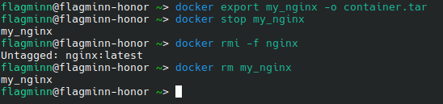
* Импортирую контейнер из .tar файла. Проверяю что создался образ. Запускаю контейнер
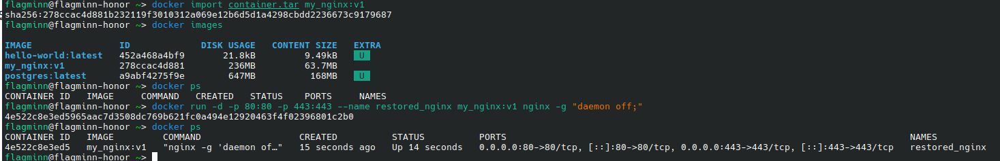

* Статистика все также на месте
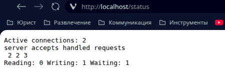