# Отчет по проекту DO7 - Docker Compose и Docker Swarm

## Part 1. Запуск нескольких Docker-контейнеров с использованием Docker Compose

- Проверка успешности парсинга конфигурационного файла `docker-compose.yml` с помощью команды `docker compose config`. Ошибок не выявлено.
  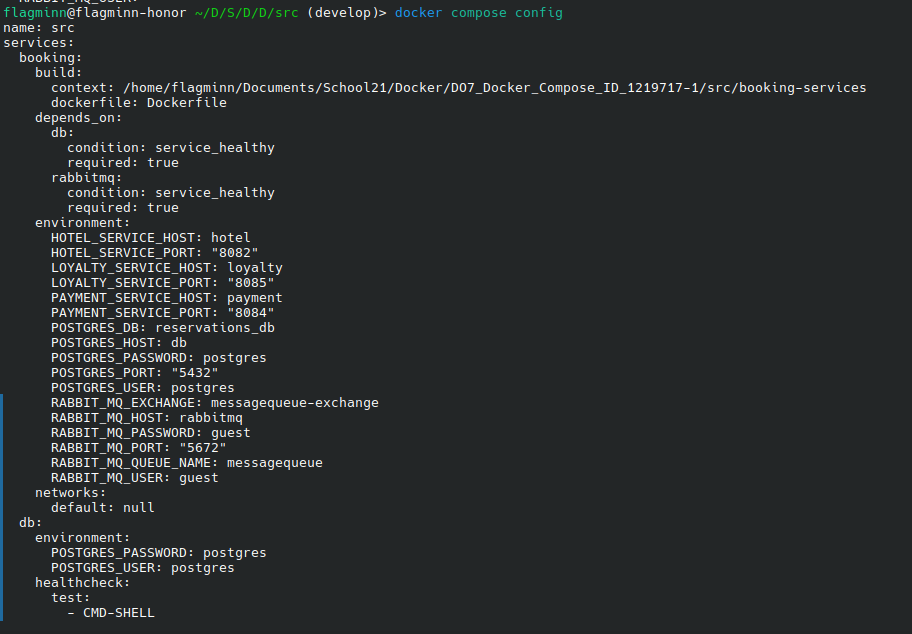
- Запуск всех контейнеров микросервисного приложения с помощью команды `docker compose up`.
  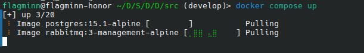
- Запуск функционального тестирования приложения с помощью Postman коллекции (`newman run application_tests.postman_collection.json`).
- Успешное прохождение всех тестов API микросервисного приложения.
  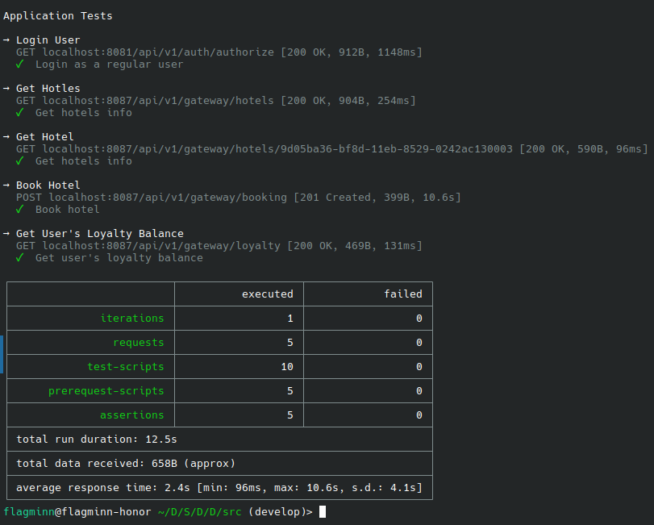

## Part 2. Создание виртуальных машин

- Установка Vagrant и инициализация конфигурации в корне проекта с помощью команды `vagrant init`. Настройка используемого базового образа `ubuntu/jammy64` в созданном `Vagrantfile`.
  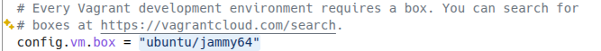
- Запуск процесса поднятия виртуальной машины с помощью команды `vagrant up`.
  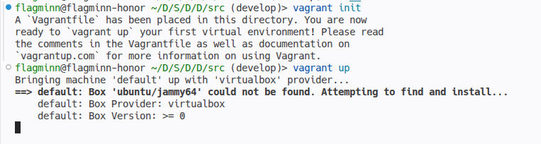
- Подтверждение успешного запуска виртуальной машины.
  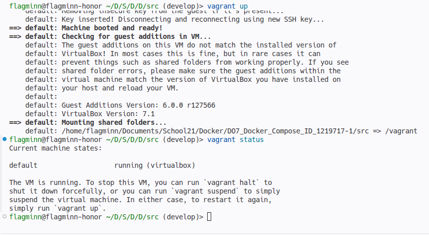
- Подключение к созданной виртуальной машине по протоколу SSH (`vagrant ssh`).
  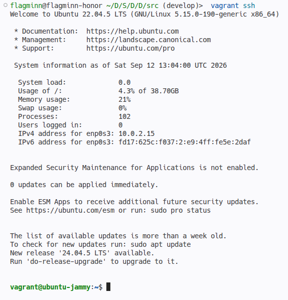
- Проверка успешности синхронизации и проброса файлов проекта в рабочую директорию виртуальной машины.
  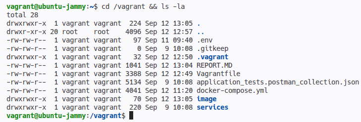
- Установка Docker и Docker Compose внутри виртуальной машины (`sudo apt update && sudo apt install -y docker.io docker-compose-v2`), добавление пользователя в группу docker, а также успешный запуск контейнеров в окружении виртуальной машины.
  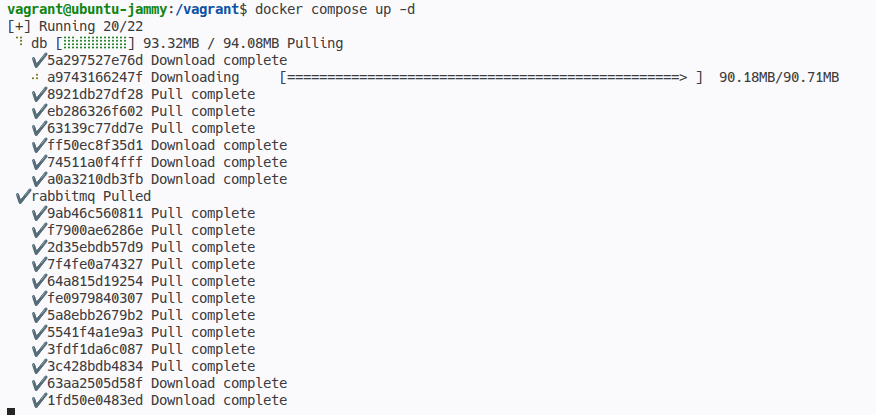
- Проверка работающих контейнеров — файловая структура и сервисы функционируют корректно, полностью повторяя структуру проекта.
  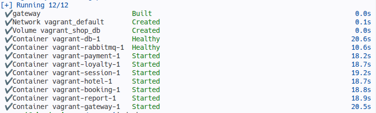
- Проверка соответствия файловой структуры виртуальной машине.
  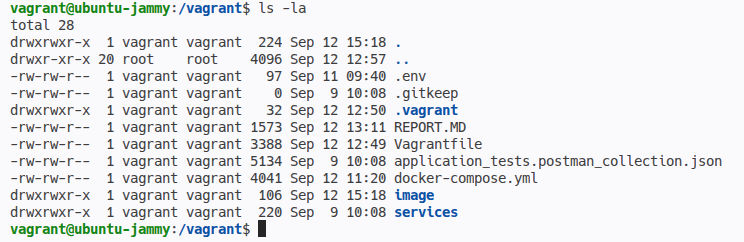
- Остановка и полное уничтожение виртуальной машины с помощью команд `vagrant halt` и `vagrant destroy`.
  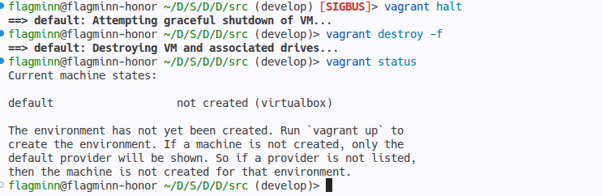

## Part 3. Создание простейшего Docker Swarm

- Тегирование и выгрузка (пуш) всех собранных образов микросервисов на Docker Hub.
  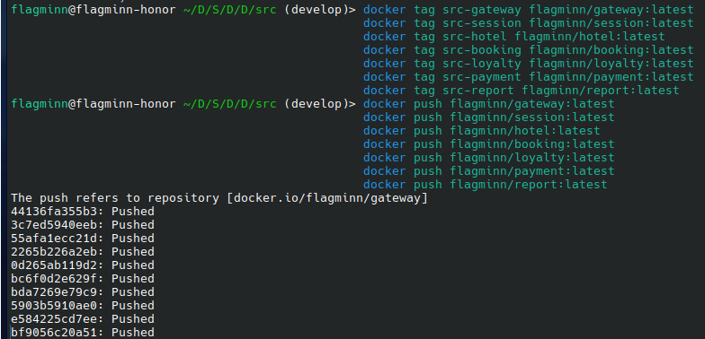
- Модификация конфигурации `Vagrantfile` для развертывания трех виртуальных узлов: `manager01`, `worker01` и `worker02`.
  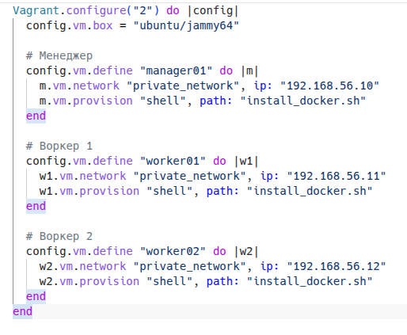
- Изменение Docker Compose файла для загрузки готовых образов из Docker Hub (замена директивы `build` на `image`).
  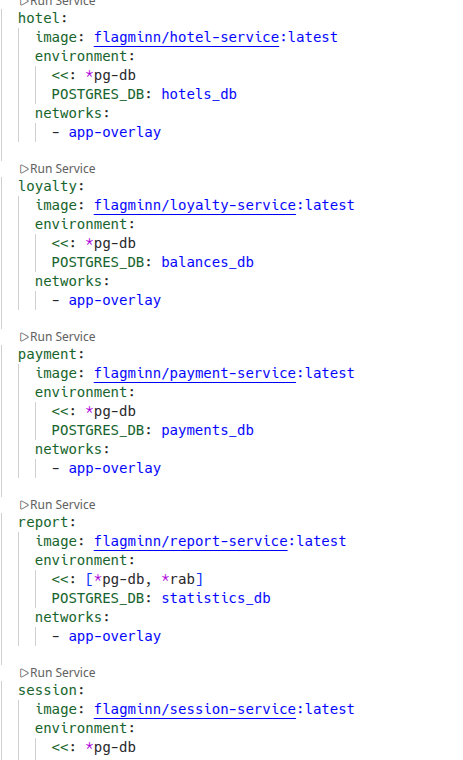
- Подготовка скрипта автоматической установки Docker и зависимостей для инициализации на виртуальных машинах.
  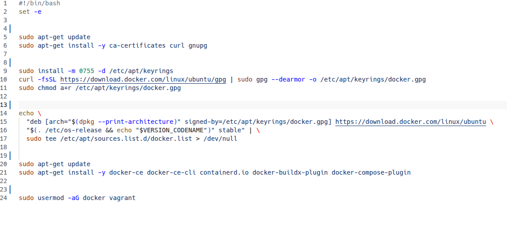
- Поднятие кластера из трех виртуальных машин с помощью Vagrant.
  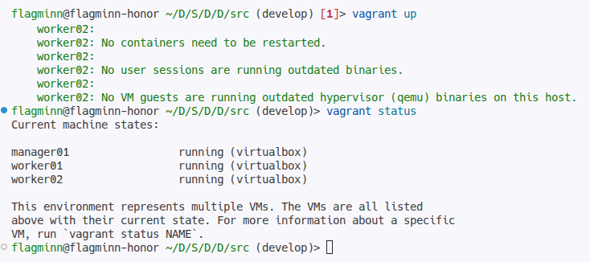
- Подключение по SSH к узлу `manager01` и инициализация Docker Swarm кластера командой `docker swarm init --advertise-addr 192.168.56.10`. Получение токена подключения и подключение узлов `worker01` и `worker02` к кластеру. Проверка успешности объединения узлов и назначения лидера с помощью команды `docker node ls`.
  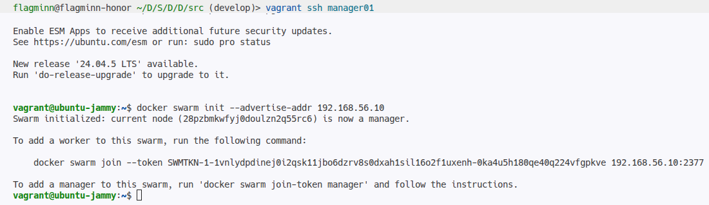
- Перенос конфигурационных файлов (`docker-compose.yml` и папки `nginx`) с хоста на управляющий узел `manager01`.
- Запуск стека сервисов с помощью команды `docker stack deploy -c docker-compose.yml s21_stack` и проверка статуса сервисов стека командой `docker stack services s21_stack`.
  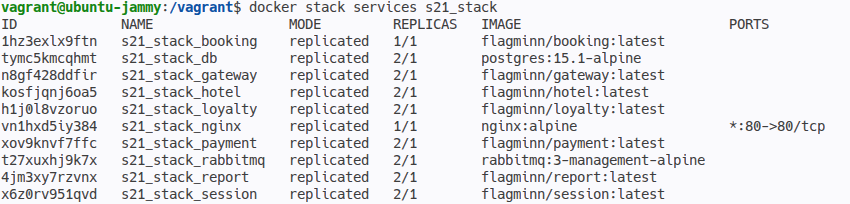
- Запуск проверки тестами Postman с хоста с указанием IP-адреса оверлейной сети и Nginx прокси: `newman run application_tests.postman_collection.json --env-var "baseUrl=http://192.168.56.10"`.
  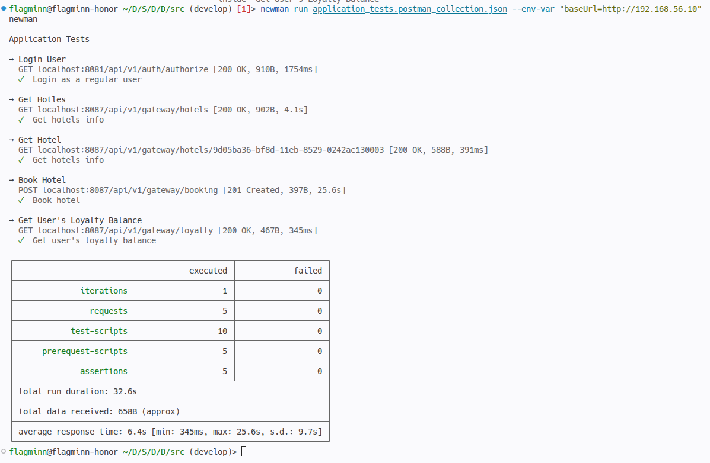
- Демонстрация распределения задач и контейнеров по узлам кластера с помощью команд `docker node ls`, `docker stack services s21_stack` и `docker stack ps s21_stack`.
  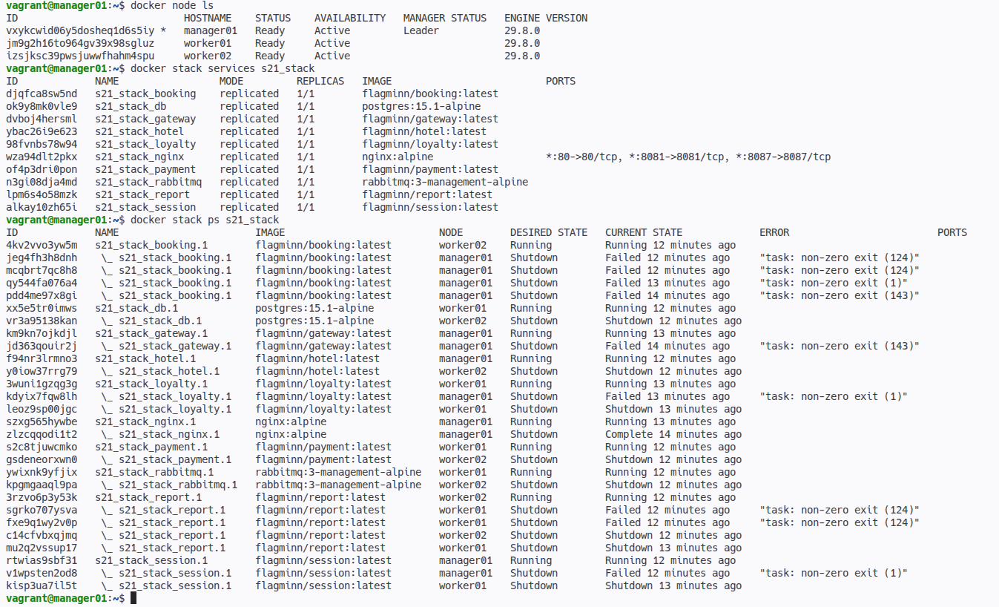
- Создание конфигурационного файла `portainer-agent-stack.yml` с рекомендованными настройками для развертывания Portainer Agent в кластере.
  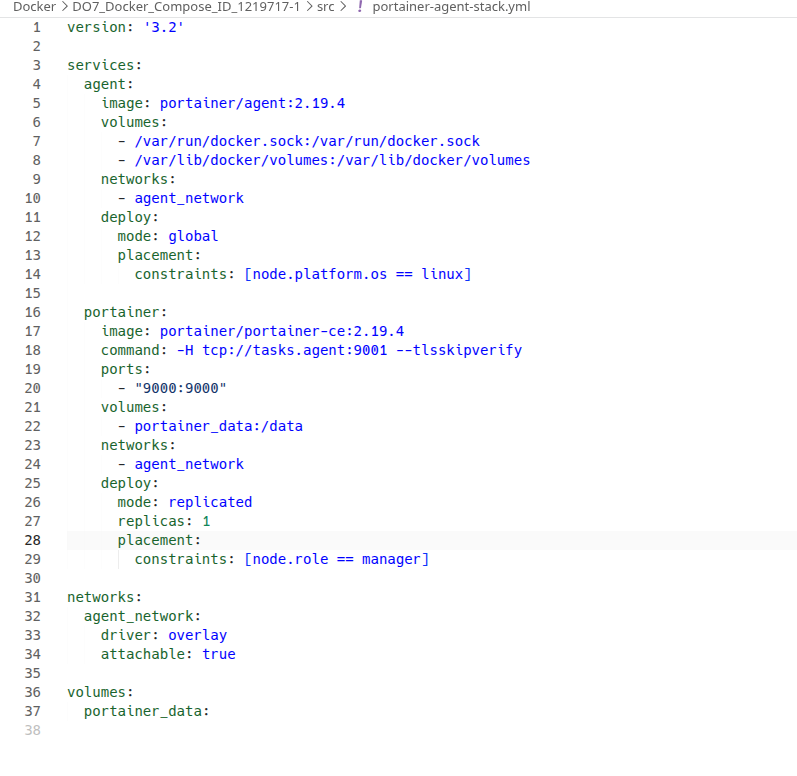
- Развертывание Portainer в виде отдельного стека на управляющем узле Swarm кластера.
  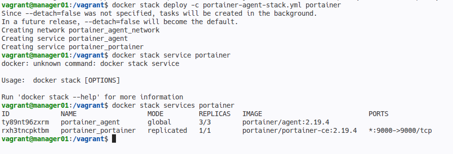
- Доступ к веб-интерфейсу Portainer через браузер по IP-адресу менеджера и визуализация запущенных задач и распределения контейнеров по узлам Swarm.
  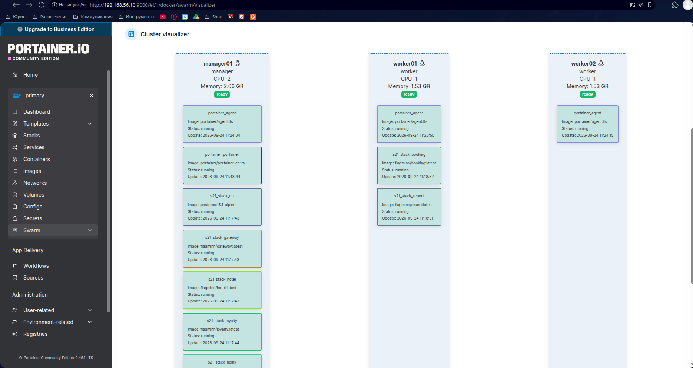
