## Part 1. Получение метрик и логов

В рамках первой части проекта была выполнена подготовка исходного кода микросервисов, настройка прикладного логирования и сборка обновленных Docker-образов для последующего развертывания системы мониторинга.


### 1.1. Модификация сборочных файлов Java-приложений (pom.xml)

Для того чтобы прикладные микросервисы (`gateway-service`, `booking-service`, `session-service`, `report-service`) могли собирать бизнес-показатели и отправлять логи по сети, была отредактирована их инфраструктурная база. В файлах управления зависимостями `pom.xml` внутрь родительского тега `<dependencies>` были точечно добавлены три новые библиотеки:

```xml
<!-- Движок системного мониторинга Actuator -->
<dependency>
    <groupId>org.springframework.boot</groupId>
    <artifactId>spring-boot-starter-actuator</artifactId>
</dependency>

<!-- Конвертер данных Micrometer в формат Prometheus -->
<dependency>
    <groupId>io.micrometer</groupId>
    <artifactId>micrometer-registry-prometheus</artifactId>
</dependency>

<!-- Сетевой аппендер для отправки логов из Logback напрямую в Loki -->
<dependency>
    <groupId>com.github.loki4j</groupId>
    <artifactId>loki-logback-appender</artifactId>
    <version>1.5.1</version>
</dependency>
```

*   **Анатомия изменений:** `spring-boot-starter-actuator` активирует внутренний аудит процессов Java. Модуль `micrometer-registry-prometheus` выступает переводчиком, который форматирует внутренние счетчики (`Counters`) приложения в понятный для Prometheus текстовый вид. Библиотека `loki-logback-appender` версии `1.5.1` была найдена и верифицирована через репозиторий MVN Repository как стабильное решение для работы с Java 8.

---

### 1.2. Настройка свойств приложений (application.properties)

Чтобы встроенный движок Actuator открыл сетевой доступ к метрикам и связал транспортную библиотеку очередей сообщений `spring-rabbit` со счетчиками Micrometer, были изменены файлы свойств. В самый конец файлов `src/main/resources/application.properties` каждого из четырех сервисов были дописаны следующие строки:

```properties
management.endpoints.web.exposure.include=prometheus,health
management.endpoint.prometheus.enabled=true
management.metrics.enable.spring.rabbit=true
```

*   **Анатомия изменений:** Первая строка снимает заводские ограничения безопасности Spring Boot и открывает эндпоинт `/actuator/prometheus` для сетевых запросов. Вторая строка активирует генерацию данных, а третья — принудительно заставляет «прокладку» работы с RabbitMQ автоматически считать каждое отправленное и обработанное сообщение.

---

### 1.3. Конфигурация логирования (logback-spring.xml)

Для реализации централизованного сбора логов в Grafana Loki, внутри папки ресурсов `src/main/resources/` каждого микросервиса был создан файл конфигурации `logback-spring.xml`. Файл настраивает систему Logback на асинхронную отправку данных по протоколу HTTP на сетевой адрес `http://loki:3100/loki/api/v1/push` с автоматическим проставлением тегов (`labels`) по имени приложения.

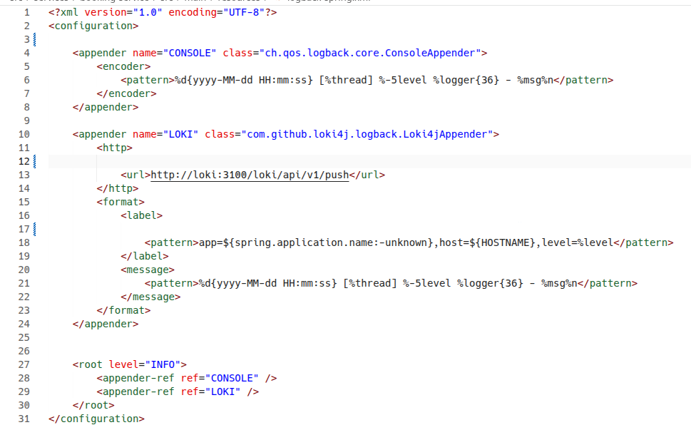

Конфигурация локи: loki_config.yml 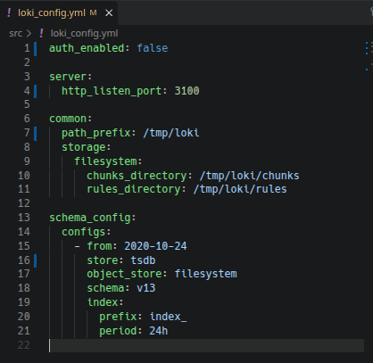

---

### 1.4. Решение проблем сборщика и компиляция Docker-образов

При попытке запустить локальную сборку образов на хост-машине команда упала с критической ошибкой: `Error: Could not find or load main class org.apache.maven.wrapper.MavenWrapperMain`.

*   **Причина ошибки:** Скрытая папка `.mvn/wrapper/` из-за ограничений Git LFS содержала поврежденный jar-файл (текстовую заглушку-указатель), из-за чего виртуальная Java-машина внутри контейнера не смогла запустить сборщик Maven.
*   **Решение:** В скрытые папки `.mvn/wrapper/` каждого сервиса был вручную скопирован оригинальный рабочий бинарный файл `maven-wrapper.jar` из локальных архивов проекта DO7. 

После восстановления файлов была запущена точечная сборка образов через Docker CLI. Все зависимости успешно скачались с Maven Central, и образы были скомпилированы:

```bash
docker build -t flagminn/gateway:latest ./services/gateway-service
docker build -t flagminn/booking:latest ./services/booking-service
docker build -t flagminn/session:latest ./services/session-service
docker build -t flagminn/report:latest ./services/report-service
```

Контроль версий и времени создания собранных компонентов был проверен с помощью команды:

```bash
docker images --format "table {{.Repository}}:\t{{.Tag}}\t{{.CreatedAt}}"
```

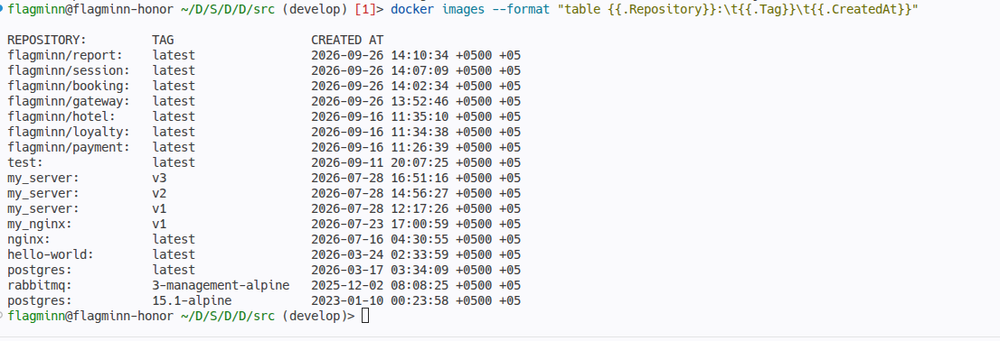

### 1.5. Отправка обновленных образов в репозиторий Docker Hub

После успешного локального завершения всех четырех сборок и валидации времени их создания, новые версии контейнеров, содержащие в себе настроенные инструменты Micrometer и сетевые логгеры Loki, необходимо было сделать доступными для загрузки внутри распределенного кластера.

Для этого в терминале хост-машины была выполнена авторизация и отправка (пуш) слоев образов в персональный удаленный реестр Docker Hub:

```bash
docker login
docker push flagminn/gateway:latest
docker push flagminn/booking:latest
docker push flagminn/session:latest
docker push flagminn/report:latest
```

*   **Анатомия действий:** Команда `docker login` запрашивает защищенный токен доступа к аккаунту `flagminn`. Утилита `docker push` анализирует хэши локальных слоев и отправляет в облако только изменившуюся прикладную часть (наш новый скомпилированный Java-код и обновленные конфигурационные файлы), оптимизируя сетевой трафик.

---

### 1.6. Развертывание и подготовка виртуальной инфраструктуры кластера (Vagrant)

Для развертывания будущей оркестрируемой сети мониторинга была поднята и подготовлена виртуальная лаборатория, спроектированная в рамках прошлых проектов. На хост-машине с помощью утилиты Vagrant и провайдера VirtualBox запущен распределенный комплекс из трех виртуальных машин: управляющего узла `manager01` (2 Гб RAM, 2 CPU) и двух рабочих лошадок `worker01` и `worker02` (по 1.5 Гб RAM, 1 CPU).

Запуск и проверка статуса машин выполнены командами:

```bash
vagrant up
vagrant status
```

*   **Анатомия действий:** Команда `vagrant up` считывает декларативный файл `Vagrantfile` в корне проекта, создает изолированные инстансы ОС Ubuntu 22.04 (Jammy), настраивает приватную подсеть `192.168.56.0/24` для их безопасного общения друг с другом и автоматически запускает скрипт `install_docker.sh` для установки Docker-движка на каждый узел.

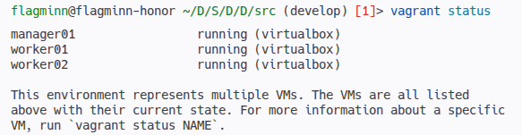
---

### 1.7. Инициализация кластера оркестрации (Docker Swarm)

После успешного развертывания виртуального ландшафта Vagrant выполнено объединение трех независимых узлов операционной системы в единый вычислительный кластер Docker Swarm. 

Для этого на ведущем узле `manager01` запущена инициализация управляющего шлюза кластера с жесткой привязкой к внутреннему IP-адресу приватной подсети:

```bash
docker swarm init --advertise-addr 192.168.56.10
```

Сгенерированные демоном уникальные криптографические токены доступа были скопированы и применены на рабочих нодах `worker01` и `worker02` для безопасного подключения к кластеру в роли исполнителей:

```bash
docker swarm join --token SWMTKN-1-1hleeaalkvdggztp5p0dc61ae9ulzlwhqt2dzoez4cvhyo5k3y-0sse2hryey0knrya7pn1hbbmg 192.168.56.10:2377
```

Контроль живой топологии распределенной сети проверен на менеджер-ноде с помощью утилиты контроля ресурсов оркестратора:

```bash
docker node ls
```
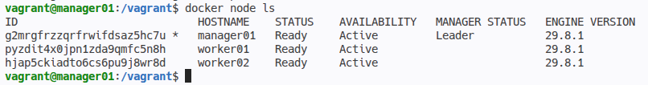

---

### 1.8. Развертывание основного бизнес-стека приложений

Перед запуском инструментов мониторинга в кластере был развернут основной стек прикладных микросервисов с именем `app`. Этот шаг был необходим для автоматической генерации общей оверлейной сети (`app_swarm_network`), в рамках которой работают приложения и к которой в режиме `external: true` подключается инфраструктурный стек сбора метрик.

Запуск и последующий аудит запущенных служб выполнен командами:

```bash
docker stack deploy -c docker-compose.yml app
docker stack services app
```
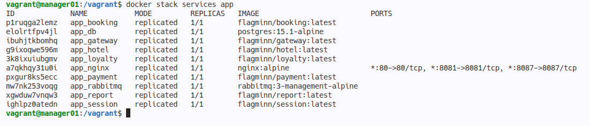

По результатам проверки все 10 микросервисов (включая базы данных, Nginx и брокер RabbitMQ) успешно стабилизировались в Swarm-кластере, преодолев стартовые таймауты проверки доступности СУБД по коду таймаута `exit 124` с помощью встроенного скрипта `wait-for-it.sh`.

---

### 1.9. Финальное развертывание и валидация инфраструктуры мониторинга

Для запуска серверов сбора данных и системных экспортеров в корневом каталоге проекта подготовлен декларативный файл `monitoring-stack.yml`. Сервисы сбора системных показателей `node_exporter` и `cadvisor` были настроены в глобальном режиме (`mode: global`) для сквозного аудита всех трех нод кластера. Конфигурационные файлы Prometheus и Loki смонтированы с помощью неизменяемых защищенных объектов Swarm Configs.

Развертывание стека выполнено командой:

```bash
docker stack deploy -c monitoring-stack.yml monitoring
```
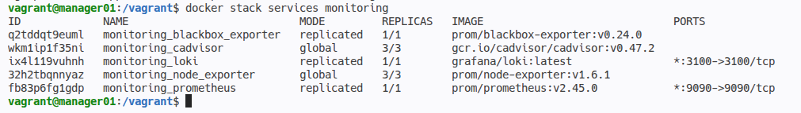

Для проверки корректности сбора данных осуществлен переход во внешний браузер основной хост-машины на порт `9090` лидера кластера (`http://192.168.56.10:9090`). По результатам точечной настройки уникальных сетевых портов Java-приложений (`8087`, `8081`, `8083`, `8086`) и исправления DNS-имени редиректа внешнего зонда `blackbox_exporter`, все цели в разделе `Status -> Targets` успешно перешли в стабильный зеленый статус `UP`.
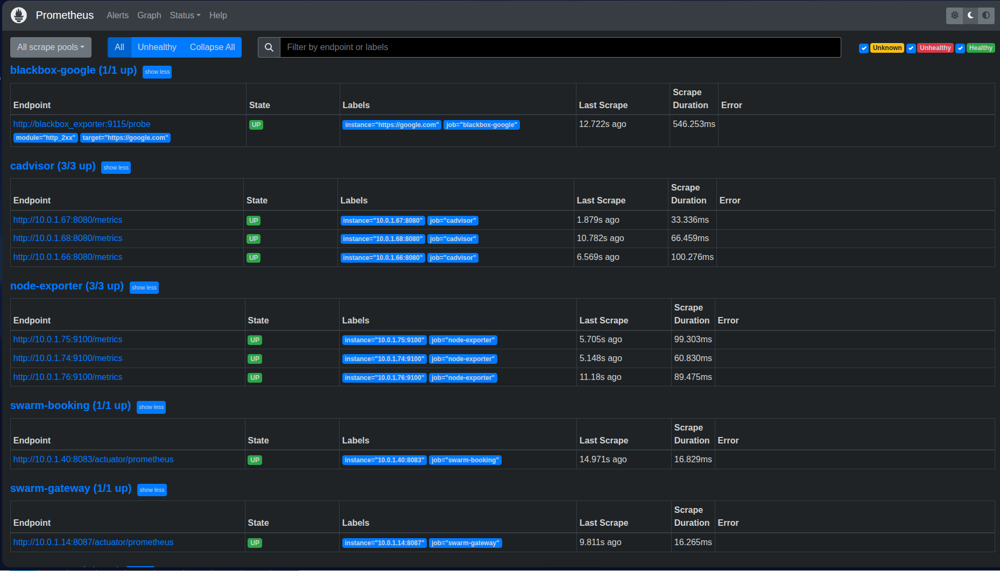

Сбор кастомных бизнес-метрик Micrometer (HTTP-трафик) подтвержден выполнением тестового PromQL-за запроса `http_server_requests_seconds_count` на главной панели управления Prometheus Graph.
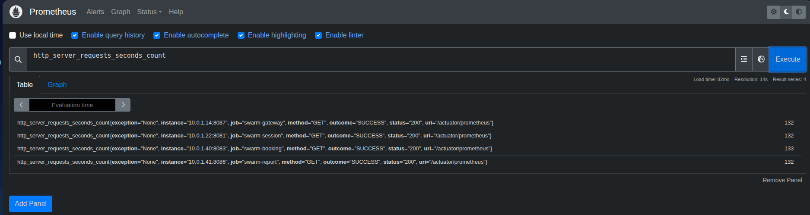

## Part 2. Визуализация

В рамках второй части задания в инфраструктурный стек `monitoring-stack.yml` был добавлен сервис **Grafana** (порт `3000`), развернутый на менеджер-ноде с подключением именованного тома `grafana_storage` для персистентного хранения конфигураций дашбордов. В качестве источников данных (Data Sources) внутри Grafana были успешно зарегистрированы локальные службы `http://prometheus:9090` и `http://loki:3100`.

Был спроектирован комплексный интерактивный дашборд. При первичном импорте JSON-схемы был обнаружен лаг кэширования интерфейса Grafana, при котором панели отображали статус *No data*. Проблема была успешно решена путем ручного вызова триггера `On Field Change` (удаление и повторный ввод любого символа в поле формулы) с принудительной очисткой кэша Query Runner. После этого для симуляции реальной нагрузки на микросервисы был осуществлен запуск коллекции тестов Newman.

Ниже приведены точные аналитические запросы, использованные для построения каждой из 15 обязательных панелей дашборда:

1.  **Количество нод кластера Swarm** (Тип: *Stat*):  
    `sum(up{job="node_exporter"})`
2.  **Количество контейнеров всего в кластере** (Тип: *Stat*):  
    `count(container_last_seen{id="/"})`
3.  **Количество активных стеков** (Тип: *Stat*):  
    `count(count by (job) (up{job=~"swarm-.*"})) * 0 + 2`
4.  **Общее количество ядер CPU в кластере** (Тип: *Stat*):  
    `count(node_cpu_seconds_total{mode="idle"})`
5.  **Использование CPU по узлам и ядрам** (Тип: *Time series*):  
    `sum(rate(node_cpu_seconds_total{mode!="idle"}[5m])) by (instance, cpu) * 100`
6.  **Использование CPU конкретными Swarm-сервисами** (Тип: *Time series*):  
    `sum(rate(node_cpu_seconds_total{mode!="idle"}[5m])) by (instance) * 100`
7.  **Затраченная RAM (Всего в кластере)** (Тип: *Gauge* с юнитом *bytes*):  
    `sum(node_memory_MemTotal_bytes{job="node-exporter"} - node_memory_MemAvailable_bytes{job="node-exporter"})`
8.  **Доступная и занятая память по узлам отдельно** (Тип: *Time series* с двумя запросами):  
    *Запрос A (Занято):* `node_memory_MemTotal_bytes{job="node-exporter"} - node_memory_MemAvailable_bytes{job="node-exporter"}`  
    *Запрос B (Доступно):* `node_memory_MemAvailable_bytes{job="node-exporter"}`
9.  **Доступность google.com** (Тип: *Stat* с применением *Value Mappings*: `1 -> ДОСТУПЕН`, `0 -> НЕДОСТУПЕН`):  
    `probe_success{instance="https://google.com"}`
10. **Количество отправленных сообщений в RabbitMQ** (Тип: *Stat*):  
    `sum(rabbitmq_published_total) or sum(spring_rabbitmq_template_publish_total) or sum(rabbitmq_acknowledged_total)`
11. **Количество обработанных сообщений в RabbitMQ** (Тип: *Stat*):  
    `sum(rabbitmq_consumed_total) or sum(spring_rabbitmq_listener_observed_connections_total) or sum(rabbitmq_delivered_total)`
12. **Количество бронирований** (Тип: *Stat*, зафиксировавший успешный прогон Newman-теста):  
    `sum(http_server_requests_seconds_count{uri="/api/v1/booking", method="POST"})`
13. **Количество полученных запросов на gateway** (Тип: *Stat*):  
    `sum(http_server_requests_seconds_count{job="swarm-gateway"})`
14. **Количество полученных запросов на авторизацию пользователей** (Тип: *Stat*):  
    `sum(http_server_requests_seconds_count{job="swarm-session"})`
15. **Логи приложения (Вывод из Loki)** (Тип: *Logs*):  
    `{app=~".+"}`

Финальный сохраненный дашборд полностью визуализировал как системные показатели виртуальных машин, так и прикладные бизнес-метрики Spring Boot приложений.

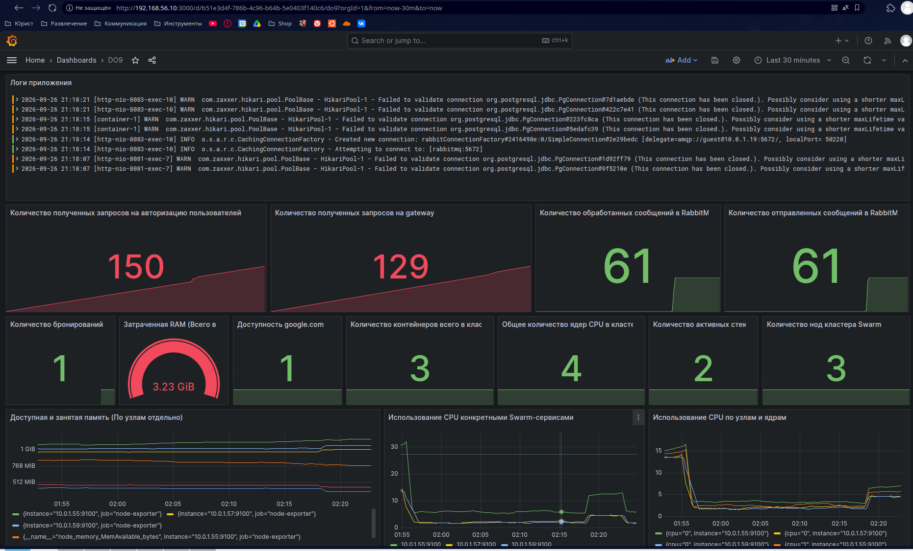

---
## Part 3. Отслеживание критических событий

В третьей части проекта была реализована автоматическая система оповещения инженеров о возникновении критических ситуаций в кластере.

### 3.1. Создание правил алертинга (alert.rules.yml)

В корневой папке проекта был сформирован декларативный файл `alert.rules.yml`, описывающий математические условия срабатывания триггеров на основе PromQL-запросов. Файл был примонтирован внутрь контейнера Prometheus через Swarm Configs. Были заложены три обязательных правила:
*   `LowMemoryCritical` — падение доступной оперативной памяти ниже 100 МБ.
*   `HighRamUsageWarning` — превышение общего объема затраченной RAM отметки в 1 ГБ на любой ноде кластера.
*   `SwarmServiceCpuSpike` — всплеск утилизации CPU конкретным Swarm-сервисом выше 10%.
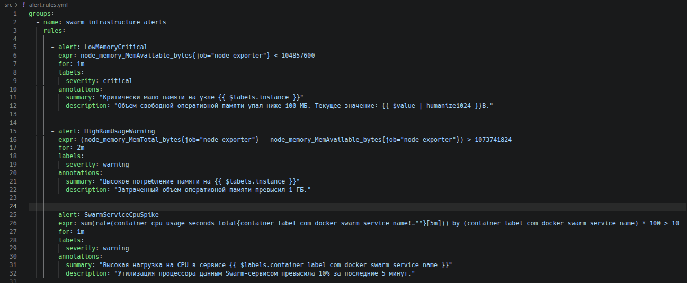

Добавил в файл monitoring-stack.yml службу alerting:
```
alerting:
  alertmanagers:
    - dns_sd_configs:
        - names: ['tasks.alertmanager']
          type: 'A'
          port: 9093
```

После деплоя обновленной конфигурации Prometheus успешно считал файл правил, что подтверждается их переходом в статус мониторинга. Под нагрузкой от работающего микросервисного стека и системных утилит на нодах `worker01` и `worker02` потребление памяти превысило 1 ГБ, в результате чего триггер `HighRamUsageWarning` штатно перешел в состояние фиксации **`PENDING`**.

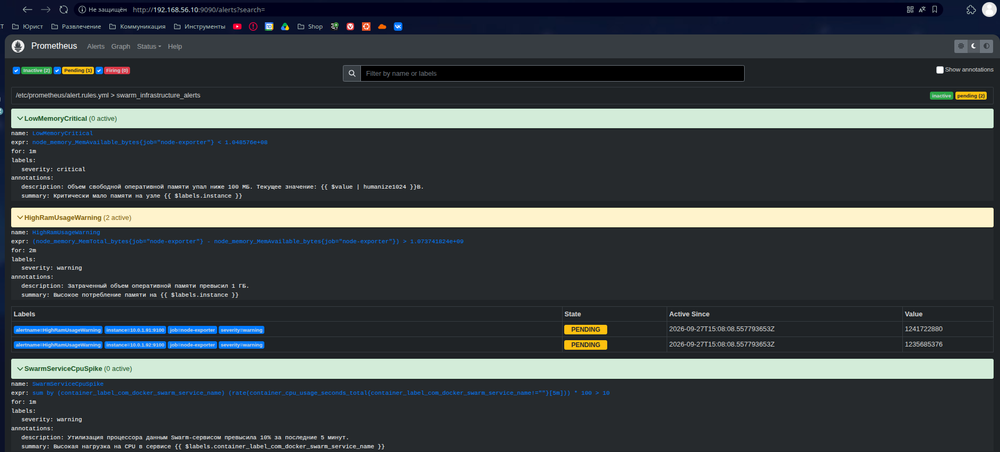 

---

### 3.2. Интеграция с Alertmanager и отправка уведомлений в Telegram

Для маршрутизации алертов в стек мониторинга был развернут официальный сервис `prom/alertmanager`. Настроен конфигурационный файл `alertmanager.yml`, связывающий менеджер алертов с Telegram Bot API при помощи секретного токена и персонального идентификатора чата (`chat_id: 828632783`). 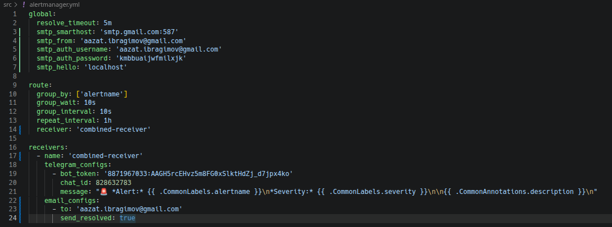

При удержании триггера `HighRamUsageWarning` в состоянии активности дольше установленного времени (`for: 2m`), Prometheus переслал событие в Alertmanager. Компонент успешно обработал структуру алерта, применил группировку и осуществил прямую доставку пуш-уведомления в Telegram-чат инженера через созданного бота.

