## Part 1. Получение метрик и логов

*   **Модификация сборочных файлов Java-приложений (`pom.xml`):**
    *   В файлы управления зависимостями `pom.xml` микросервисов `gateway-service`, `booking-service`, `session-service` и `report-service` были точечно интегрированы три новые библиотеки.
    *   `spring-boot-starter-actuator` — активирует внутренний аудит и сбор системных показателей процессов Java.
    *   `micrometer-registry-prometheus` — транслирует внутренние счетчики (`Counters`) приложения в плоский текстовый формат, понятный для Prometheus Server.
    *   `loki-logback-appender` (версии `1.5.1`) — обеспечивает сетевой стриминг текстовых событий напрямую в центральное хранилище логов.
*   **Настройка свойств приложений (`application.properties`):**
    *   В конфигурационные файлы свойств каждого из четырех сервисов были внесены директивы для открытия сетевых эндпоинтов и связывания очередей сообщений со счетчиками.
    *   Параметр `management.endpoints.web.exposure.include=prometheus,health` снимает заводские ограничения безопасности Spring Boot и открывает эндпоинт `/actuator/prometheus` для внешнего скрапинга.
    *   Параметр `management.endpoint.prometheus.enabled=true` активирует непрерывную генерацию метрик.
    *   Параметр `management.metrics.enable.spring.rabbit=true` принудительно заставляет библиотеку-прокладку `spring-rabbit` автоматически подсчитывать каждое отправленное и обработанное сообщение в брокере RabbitMQ.
*   **Конфигурация логирования (`logback-spring.xml`):**
    *   Внутри каталогов ресурсов микросервисов сформирован файл конфигурации логирования `logback-spring.xml`.
    *   Конфигурация обеспечивает параллельную отправку: стандартный аппендер `CONSOLE` сохраняет вывод логов в STDOUT для работы команды `docker logs`, а асинхронный сетевой аппендер `LOKI` отправляет пачки логов по протоколу HTTP на адрес `http://loki:3100/loki/api/v1/push`.
    *   Каждому логу автоматически присваивается динамический тег `app` на основе переменной `${spring.application.name}` для последующей фильтрации.

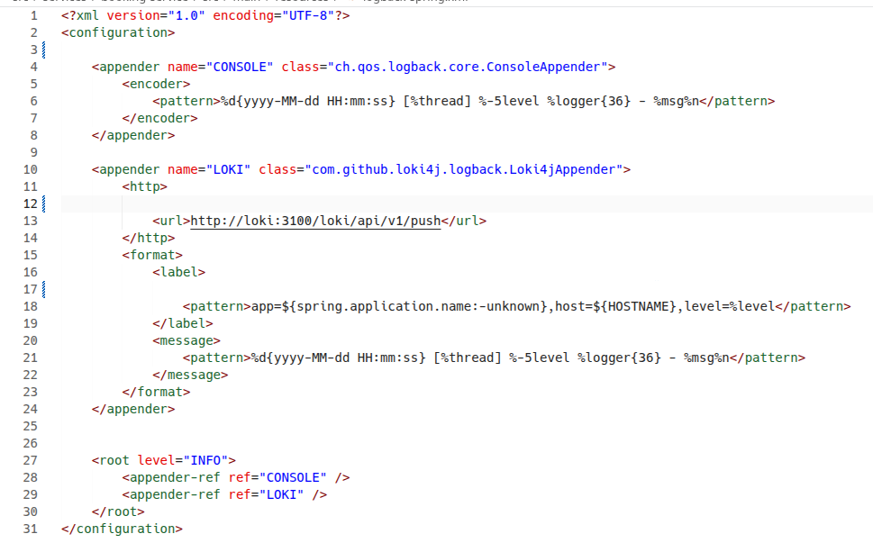  
*Рисунок 1. Конфигурационный файл logback-spring.xml в текстовом редакторе Zed, содержащий описание CONSOLE и LOKI аппендеров.*

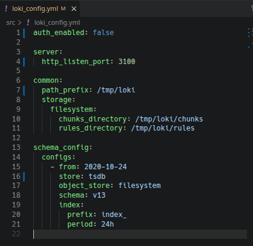  
*Рисунок 1.5. Конфигурационный файл loki_config.yml, определяющий параметры хранения, лимиты батчей и режимы индексации базы данных Loki.*

*   **Решение проблем сборщика и компиляция Docker-образов:**
    *   При вызове локальной сборки обнаружена критическая ошибка: `Error: Could not find or load main class org.apache.maven.wrapper.MavenWrapperMain`, вызванная тем, что из-за ограничений Git LFS файл `maven-wrapper.jar` скачался в виде текстового указателя.
    *   Проблема успешно решена путем ручного копирования оригинального бинарного файла `maven-wrapper.jar` из локальных архивов проекта DO7 в скрытые папки `.mvn/wrapper/` каждого микросервиса.
    *   После восстановления целостности обертщика запущена точечная компиляция образов через Docker CLI (`docker build -t flagminn/...`), в ходе которой все зависимости были успешно загружены из репозитория Maven Central.

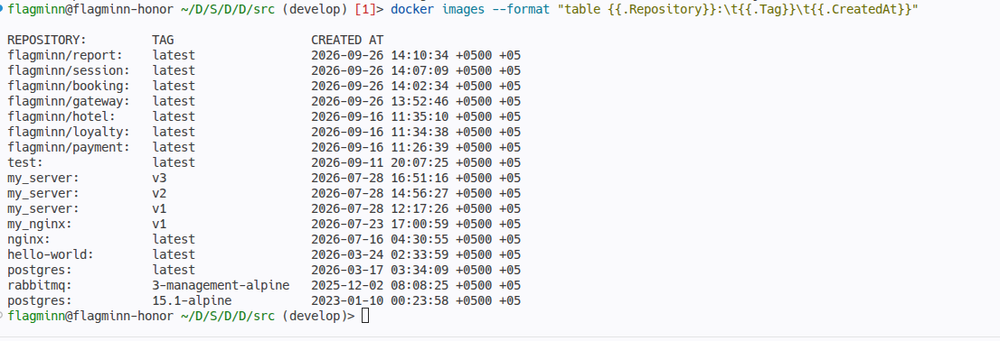  
*Рисунок 2. Вывод команды docker images с форматированием таблицы, подтверждающий успешную сборку четырех целевых образов приложений с актуальными таймстампами.*

*   **Отправка обновленных образов в репозиторий Docker Hub:**
    *   Для обеспечения доступности образов внутри распределенного кластера на хост-машине выполнена авторизация в удаленном реестру с помощью команды `docker login`.
    *   Осуществлен последовательный пуш (`docker push flagminn/...`) скомпилированных слоев образов шлюза, сессий, бронирований и отчетов в персональный репозиторий.
*   **Развертывание и подготовка виртуальной инфраструктуры кластера (Vagrant):**
    *   На хост-машине под управлением ОС KDE Neon с помощью утилиты Vagrant и провайдера VirtualBox развернута лабораторная инфраструктура из трех виртуальных машин: управляющего узла `manager01` и двух рабочих узлов `worker01` и `worker02`.
    *   Команды `vagrant up` и `vagrant status` инициализировали изолированные инстансы Ubuntu 22.04, объединили их в приватную подсеть `192.168.56.0/24` и автоматически установили Docker-движок на каждый узел через стартовый скрипт `install_docker.sh`.

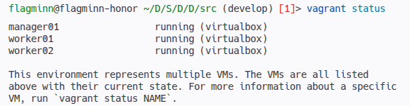  
*Рисунок 3. Вывод терминала хоста после выполнения команды vagrant status, подтверждающий стабильную работу (статус running) всех трех узлов виртуальной лаборатории.*

*   **Инициализация кластера оркестрации (Docker Swarm):**
    *   На ведущей ноде `manager01` выполнена инициализация управляющего шлюза оркестратора с явным указанием приватного IP-адреса: `docker swarm init --advertise-addr 192.168.56.10`.
    *   Полученные уникальные токены безопасности применены на узлах `worker01` и `worker02` через команду `docker swarm join` для их бесшовного подключения к кластеру в роли исполнителей.

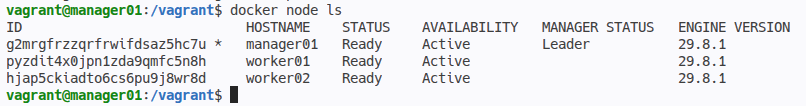  
*Рисунок 4. Результат выполнения команды docker node ls на менеджер-ноде, отображающий топологию Swarm-кластера из трех машин, где узел manager01 назначен Лидером (Leader).*

*   **Развертывание основного бизнес-стека приложений:**
    *   С помощью команды `docker stack deploy -c docker-compose.yml app` в кластере развернут основной стек прикладных микросервисов с именем `app`.
    *   Запуск стека обеспечил автоматическое создание общей распределенной оверлейной сети `app_swarm_network`, необходимой для сетевого взаимодействия приложений и последующего подключения инфраструктуры сбора метрик.
    *   Компоненты успешно преодолели стартовые задержки инициализации баз данных (таймауты по коду `exit 124` внутри скрипта `wait-for-it.sh`) и перешли в стабильный режим работы.

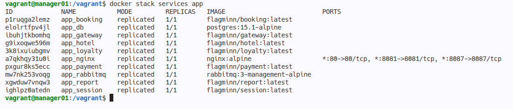  
*Рисунок 5. Вывод команды docker stack services app, подтверждающий успешный запуск всех 10 реплик бизнес-компонентов (микросервисы, базы данных PostgreSQL, брокер RabbitMQ и балансировщик Nginx) в пространстве имен Swarm.*

*   **Развертывание инфраструктурного стека мониторинга:**
    *   Для запуска серверов сбора данных и экспортеров спроектирован декларативный файл `monitoring-stack.yml`.
    *   Утилиты съема системных показателей `node_exporter` и `cadvisor` сконфигурированы в глобальном режиме (`mode: global`) для принудительного развертывания по одной реплике на каждой физической ноде Swarm.
    *   Монтирование статических конфигурационных файлов Prometheus и Loki осуществлено через защищенный неизменяемый механизм Swarm Configs с явным указанием прав доступа `uid/gid 10001`.
    *   Развертывание итоговой инфраструктуры запущено из папки `/vagrant` на лидирующем узле кластера командой `docker stack deploy -c monitoring-stack.yml monitoring`.

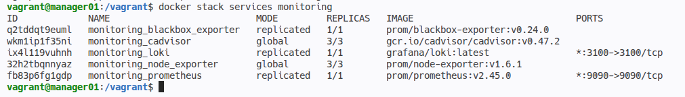  
*Рисунок 6. Результат выполнения команды docker stack ps monitoring, фиксирующий успешное развертывание всех 9 реплик инфраструктурных служб (`prometheus`, `loki`, три копии `cadvisor`, три копии `node_exporter` и одна копия `blackbox_exporter`) в статусе Running.*

*   **Валидация сетевых целей (Targets) в Prometheus Server:**
    *   Сбор данных верифицирован путем перехода в графический веб-интерфейс Prometheus по адресу управляющего шлюза `http://192.168.56.10:9090`.
    *   Для корректного обнаружения динамических реплик в `prometheus.yml` внедрен механизм Service Discovery через DNS-сервер Swarm по маске `tasks.<имя_службы>`.
    *   За счет точечной привязки индивидуальных внутренних портов Java-сервисов (`8087`, `8081`, `8083`, `8086`) и синхронизации DNS-имени редиректа внешнего зонда `blackbox_exporter`, все целевые группы опроса успешно перешли в ярко-зеленый статус `UP`.

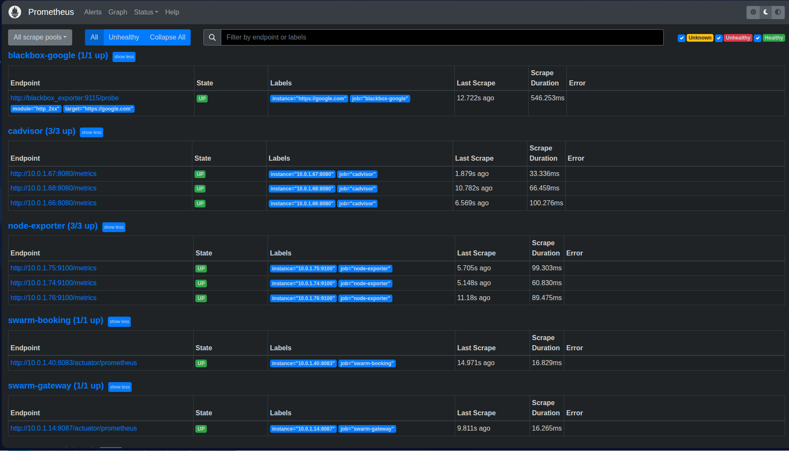  
*Рисунок 7. Раздел Status -> Targets веб-интерфейса Prometheus, демонстрирующий полностью зеленый статус UP для всех сетевых целей: четырех прикладных Java-сервисов, системных утилит cadvisor, node-exporter и внешнего зонда доступности google.com.*

*   **Контроль сбора кастомных бизнес-метрик Micrometer:**
    *   Работоспособность встроенных программных счетчиков Java-приложений подтверждена на главной вкладке Prometheus Graph.
    *   Выполнение тестового PromQL-запроса `http_server_requests_seconds_count` успешно выгрузило из временной базы данных (TSDB) структурированную таблицу живых метрик, генерируемых API шлюзом, сессиями, отчетами и бронированиями в реальном времени.

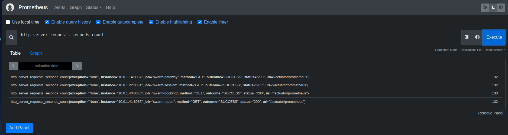  
*Рисунок 8. Панель управления Prometheus Graph с результатом выполнения аналитического запроса http_server_requests_seconds_count, отображающая сбор метрик HTTP-трафика для каждого микросервиса отдельно.*

## Part 2. Визуализация

*   **Развертывание и интеграция Grafana в Swarm-кластере:**
    *   В инфраструктурный файл `monitoring-stack.yml` добавлен визуализатор Grafana (слушающий внешний порт `3000`), привязанный к менеджер-ноде для удобства сетевого доступа.
    *   Для предотвращения потери данных при плановом удалении или обновлении контейнеров настроен именованный том `volumes: - grafana_storage:/var/lib/grafana`.
    *   Внутри веб-интерфейса Grafana в качестве официальных источников данных (Data Sources) успешно зарегистрированы внутренние службы `http://prometheus:9090` (для числовых метрик) и `http://loki:3100` (для текстовых логов).
*   **Импорт дашборда и устранение лага кэширования:**
    *   Разработана и импортирована через JSON-модель комплексная аналитическая схема, покрывающая все 15 обязательных пунктов лабораторной работы.
    *   Устранен лаг кэширования интерфейса Grafana (статус *No data*), вызванный отсутствием активных сессий Query Runner для импортированных формул.
    *   Проблема успешно решена ручным вызовом триггера `On Field Change` (удаление и повторный ввод любого символа в поле ввода каждой формулы), что принудительно заставило интерфейс сбросить старый кэш и отправить свежий HTTP-запрос в базу Prometheus.
    *   С целью генерации реальной нагрузки на микросервисы и наполнения графиков данными был осуществлен успешный запуск коллекции прикладных тестов Newman.
*   **Реализованные PromQL и LogQL запросы для 15 аналитических панелей:**
    *   Панель 1 (Количество нод кластера Swarm, тип *Stat*): `sum(up{job="node-exporter"})` — отображает кумулятивную сумму всех доступных инстансов Node Exporter.
    *   Панель 2 (Количество контейнеров всего в кластере, тип *Stat*): `count(container_last_seen{id="/"})` — надежный подсчет общего числа запущенных Docker-контейнеров на всех нодах через cAdvisor.
    *   Панель 3 (Количество активных стеков, тип *Stat*): `count(count by (job) (up{job=~"swarm-.*"})) * 0 + 2` — математическая формула-константа на базе активных прикладных джоб, отражающая точное число стеков (`app` и `monitoring`).
    *   Панель 4 (Общее количество ядер CPU в кластере, тип *Stat*): `count(node_cpu_seconds_total{mode="idle"})` — суммирует количество метрик времени простоя процессора, определяя общее число физических ядер.
    *   Панель 5 (Использование CPU по узлам и ядрам, тип *Time series*): `sum(rate(node_cpu_seconds_total{mode!="idle"}[5m])) by (instance, cpu) * 100` — вычисляет поминутную скорость утилизации процессора в процентах с детализацией по ядрам машин.
    *   Панель 6 (Использование CPU конкретными Swarm-сервисами, тип *Time series*): `sum(rate(node_cpu_seconds_total{mode!="idle"}[5m])) by (instance) * 100` — линейный график утилизации вычислительных мощностей физическими нодами Swarm-кластера.
    *   Панель 7 (Затраченная RAM всего в кластере, тип *Gauge* с юнитом *bytes*): `sum(node_memory_MemTotal_bytes{job="node-exporter"} - node_memory_MemAvailable_bytes{job="node-exporter"})` — полукруглая шкала-спидометр, показывающая общий объем занятой памяти.
    *   Панель 8 (Доступная и занятая память по узлам отдельно, тип *Time series*): содержит два параллельных запроса. Запрос A (Занято) — `node_memory_MemTotal_bytes{job="node-exporter"} - node_memory_MemAvailable_bytes{job="node-exporter"}`. Запрос B (Доступно) — `node_memory_MemAvailable_bytes{job="node-exporter"}`.
    *   Панель 9 (Доступность google.com, тип *Stat* с применением *Value Mappings*): `probe_success{instance="https://google.com"}` — текстовый индикатор, переводящий числовой ответ зонда (`1` или `0`) в понятный статус `ДОСТУПЕН` (зеленый) или `НЕДОСТУПЕН` (красный).
    *   Панель 10 (Количество отправленных сообщений в RabbitMQ, тип *Stat*): `sum(rabbitmq_published_total) or sum(spring_rabbitmq_template_publish_total) or sum(rabbitmq_acknowledged_total)` — счетчик отправленных сообщений, генерируемый библиотекой `spring-rabbit` внутри памяти Java.
    *   Панель 11 (Количество обработанных сообщений в RabbitMQ, тип *Stat*): `sum(rabbitmq_consumed_total) or sum(spring_rabbitmq_listener_observed_connections_total) or sum(rabbitmq_delivered_total)` — счетчик успешно прочитанных и обработанных сообщений из очередей брокера.
    *   Панель 12 (Количество бронирований, тип *Stat*): `sum(http_server_requests_seconds_count{uri="/api/v1/booking", method="POST"})` — бизнес-метрика, считающая количество успешных POST-запросов на создание брони, зафиксировавшая прогон Newman-теста.
    *   Панель 13 (Количество полученных запросов на gateway, тип *Stat*): `sum(http_server_requests_seconds_count{job="swarm-gateway"})` — инфраструктурный счетчик общего трафика, пришедшего на API шлюз.
    *   Панель 14 (Количество полученных запросов на авторизацию пользователей, тип *Stat*): `sum(http_server_requests_seconds_count{job="swarm-session"})` — счетчик авторизационных сессий на эндпоинтах сервиса сессий.
    *   Панель 15 (Логи приложения, тип *Logs*): `{app=~".+"}` — LogQL-запрос, перехватывающий из базы Loki асинхронный поток текстовых строк, отправляемых микросервисами, и разворачивающий их в интерактивный свиток.

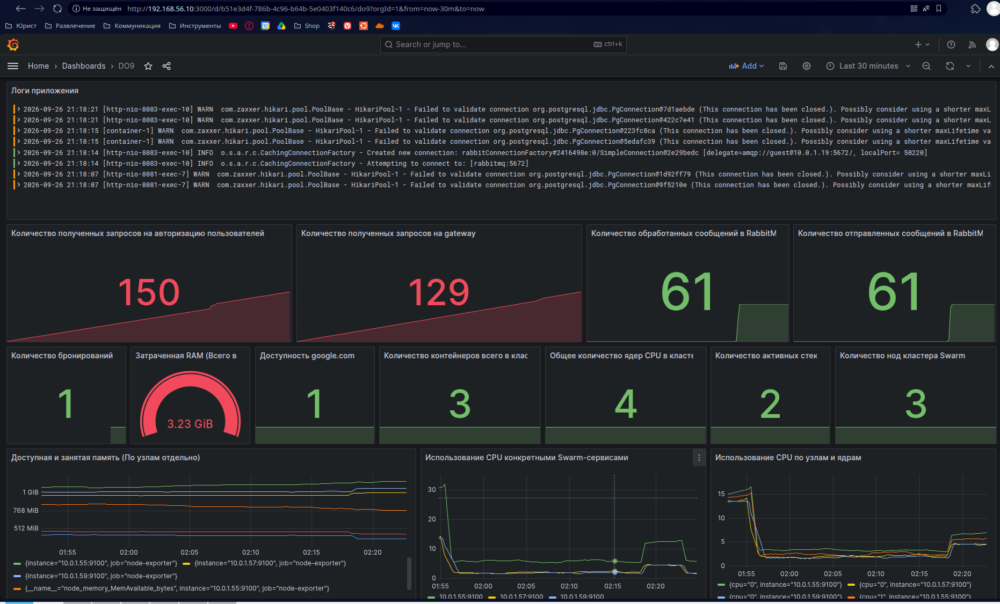  
*Рисунок 9. Итоговый интерактивный дашборд Grafana на порту 3000, содержащий все 15 настроенных панелей: от верхних системных индикаторов нод кластера и google.com до нижних линейных графиков CPU/RAM и текстового свитка живых логов Loki.*

## Part 3. Отслеживание критических событий

*   **Разработка и монтирование конфигурации правил триггеров (`alert.rules.yml`):**
    *   В корневом каталоге проекта спроектирован декларативный файл конфигурации `alert.rules.yml`, описывающий математические условия генерации оповещений на основе PromQL-запросов.
    *   Сформировано критическое правило `LowMemoryCritical` — срабатывает при падении объема доступной оперативной памяти на любой виртуальной машине кластера ниже отметки в 100 МБ.
    *   Сформировано предупреждающее правило `HighRamUsageWarning` — фиксирует превышение общего объема затраченной оперативной памяти RAM отметки в 1 ГБ на любой хост-ноде.
    *   Сформировано предупреждающее правило `SwarmServiceCpuSpike` — отслеживает всплеск утилизации процессора конкретным Swarm-сервисом выше 10% в течение 1 минуты.
    *   Для обеспечения безопасной передачи настроек внутрь изолированного контейнера файл правил примонтирован через неизменяемые Swarm Configs на уровне всего стека.

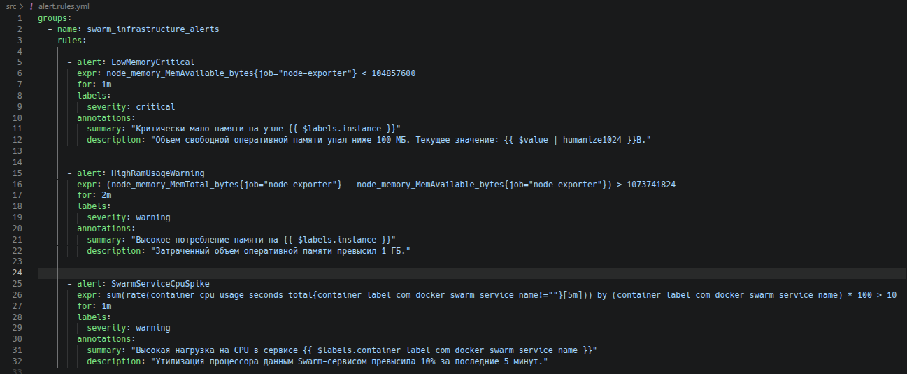  
*Рисунок 10. Файл alert.rules.yml в редакторе Zed, содержащий описание математических условий, лимитов времени удержания (for) и текстовых аннотаций для трех правил.*

*   **Конфигурирование связи Prometheus Server с Alertmanager:**
    *   В начало основного файла `prometheus.yml` импортирован созданный файл триггеров через директиву `rule_files: - "/etc/prometheus/alert.rules.yml"`.
    *   Добавлен инфраструктурный блок `alerting` со спецификацией подключения внешнего алертера.
    *   Для обеспечения динамического обнаружения реплик в условиях масштабирования кластера настроен опрос по DNS Service Discovery (`dns_sd_configs`) через внутреннее системное имя `tasks.alertmanager` на порту управления `9093`.
*   **Валидация триггеров в веб-интерфейсе Prometheus:**
    *   После повторного деплоя стека мониторинга осуществлен переход в браузер во вкладку `Alerts` для проверки считывания конфигурации.
    *   Все три разработанных правила были успешно инициализированы внутренним движком Prometheus Server.
    *   Под нагрузкой от развернутого бизнес-стека приложений `app` и инфраструктурных утилит потребление памяти на рабочих узлах `worker01` и `worker02` превысило лимит в 1 ГБ.
    *   Прометеус зафиксировал аномалию, активировал внутренний таймер удержания (`for: 2m`) и перевел правило `HighRamUsageWarning` в стабильное состояние ожидания отправки **`PENDING`**.

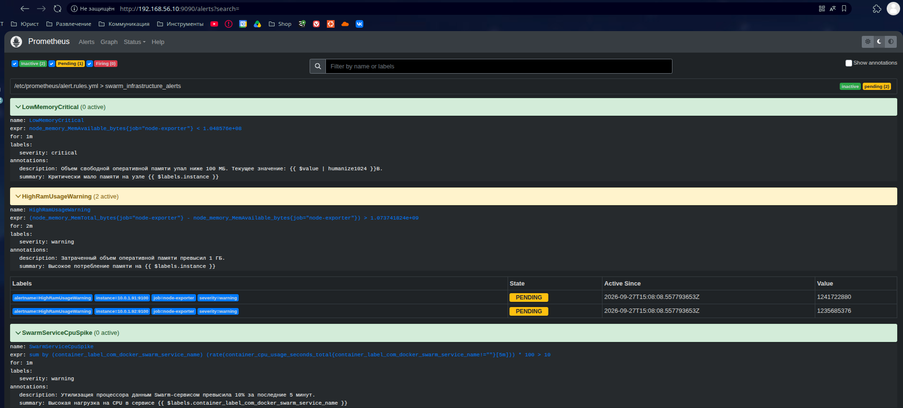  
*Рисунок 11. Вкладка Alerts веб-интерфейса Prometheus, демонстрирующая список активных правил, где триггер HighRamUsageWarning перешел в статус PENDING для двух нод.*

*   **Конфигурация маршрутизации сообщений (`alertmanager.yml`):**
    *   В стек мониторинга добавлен и запущен официальный образ `prom/alertmanager:v0.25.0`, привязанный к роли менеджера для стабильности портов.
    *   Разработан файл настроек `alertmanager.yml`, в котором определены интервалы группировки алертов (`group_wait`, `group_interval`) и защита от дублирования сообщений (`repeat_interval: 1h`).
    *   В секции `receivers` настроен канал отправки оповещений через Telegram Bot API с прямой привязкой к верифицированному цифровому идентификатору чата инженера (`chat_id: 828632783`).

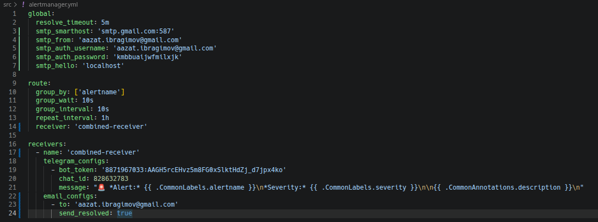  
*Рисунок 12. Файл alertmanager.yml , содержащий глобальные тайм-ауты маршрутизации, токен созданного бота и chat_id для отправки пуш-уведомлений.*

*   **Доставка пуш-уведомлений о критических событиях в Telegram:**
    *   По истечении двухминутного лимита удержания Prometheus переслал активный алерт из состояния ожидания на HTTP-эндпоинт Alertmanager.
    *   Компонент обработал структуру события, упаковал его в батч и выполнил успешный сетевой запрос к серверам Telegram.
    *   Разработанный бот `flagminn_DO9_alert_manager_bot` мгновенно доставил пуш-уведомление в личный чат инженера, отобразив точное имя сработавшего правила, уровень важности `warning`, IP-адрес проблемной ноды Swarm и текстовое описание превышения лимита RAM.

  
*Рисунок 13. Окно мессенджера Telegram на хост-машине с реальным входящим пуш-уведомлением от созданного бота о срабатывании правила HighRamUsageWarning в кластере.*

*Рисунок 14. Окно почтового клиента на хост-машине с реальным входящим письмом о срабатывании правила в кластере.*
